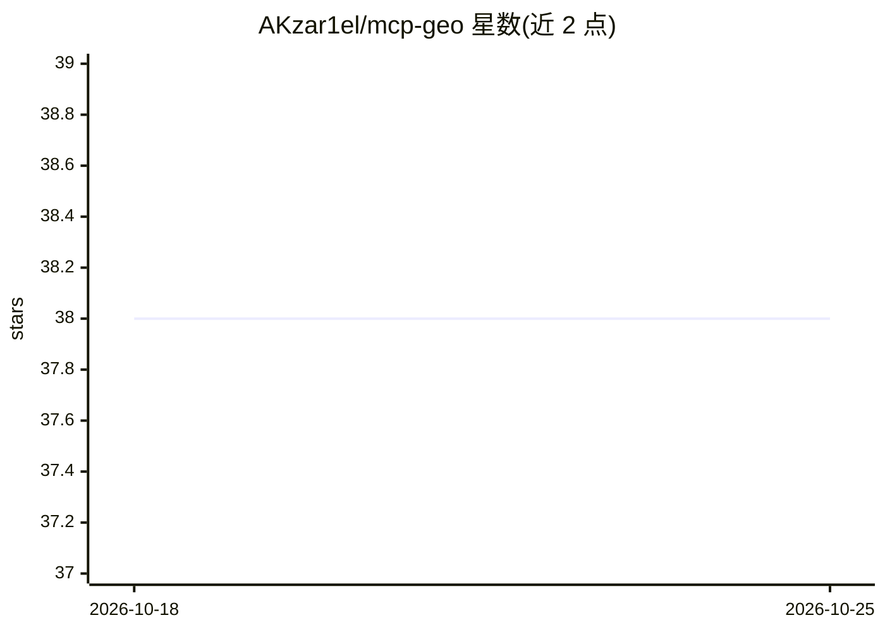

# AKzar1el/mcp-geo

⭐ 38 · TypeScript · MIT · 推送 2026-10-25 · [GitHub](https://github.com/AKzar1el/mcp-geo) · [官网](https://geo-mcp.digestseo.com/audit) · 个人维护

**追踪品牌在七个 AI 搜索平台被引用情况的可自托管 MCP 服务器**

名为 DigestSEO/mcp-geo 的 MCP 服务器，用于 SEO 与 GEO（生成式引擎优化）场景下的品牌可见性监测：通过自带 API 密钥调用 OpenAI、Anthropic、Gemini、Perplexity、xAI、SerpAPI 等引擎执行扫描，本地 stdio 运行、数据留在本机，未配置密钥的引擎自动跳过。提供面向 Claude Desktop/Code、Codex、Amp、OpenCode、LibreChat、Flowise 等十余种 MCP 客户端的接入配置，也可自托管到 Cloudflare Workers 以远程 MCP 方式使用（OAuth/DCR）。需 Node.js 22.13+，另提供 EUR 99 的付费客户就绪审计服务。

## 筛选速览

| 维度 | 判定 | 备注 |
|---|---|---|
| AI 角色 | `ai-ecosystem` | LLM/agent 周边工具 |
| 许可风险 | `permissive` | MIT |
| 部署形态 | `self-host` | docker 或自建部署 |
| 模型依赖 | — | README 未给出锁定关系 |
| 硬件要求 | — | 无带数字的原话,不猜 |
| 安装摩擦 | `low` | 无编译、无系统依赖或容器化 |
| 成熟度 | — | 结构信号不足 |

## 能力要点

- 本地 stdio 运行，数据保留在本机，各引擎密钥可选且缺失时跳过
- 覆盖 Claude Desktop/Claude Code、Codex、Amp、OpenCode、LibreChat、Flowise 等十余种 MCP 客户端接入指引
- 支持自托管 Cloudflare Workers 远程 MCP（OAuth 动态客户端注册）
- 零密钥即可完成 MCP 工具发现

## 适用场景

- 在 MCP 客户端中监测品牌在 AI 搜索平台的引用与可见性
- SEO/GEO 团队自托管后接入 Perplexity、ChatGPT 等做远程扫描
- 为 AI 可见性审计收集引擎侧数据

## 场景标签

 · 领域:SEO/AI 可见性监测

## 证据(README 行号)

> L17: Runs locally over stdio with your own API keys — all data stays on your machine (see Privacy Policy). Set at least 
> L30: **ChatGPT (remote MCP):** ChatGPT does not connect directly to local STDIO MCP servers. For ChatGPT, use the self-h

## 星数曲线

2026-10-18 38 → 2026-10-25 38（+0）

---
*卡片 v1 · prompt 1.4 · 生成 2026-10-25 · 置信度 mid · 依据 README sha `2a2b40db9cfe` · [字段定义](../../DATASET.md)*
