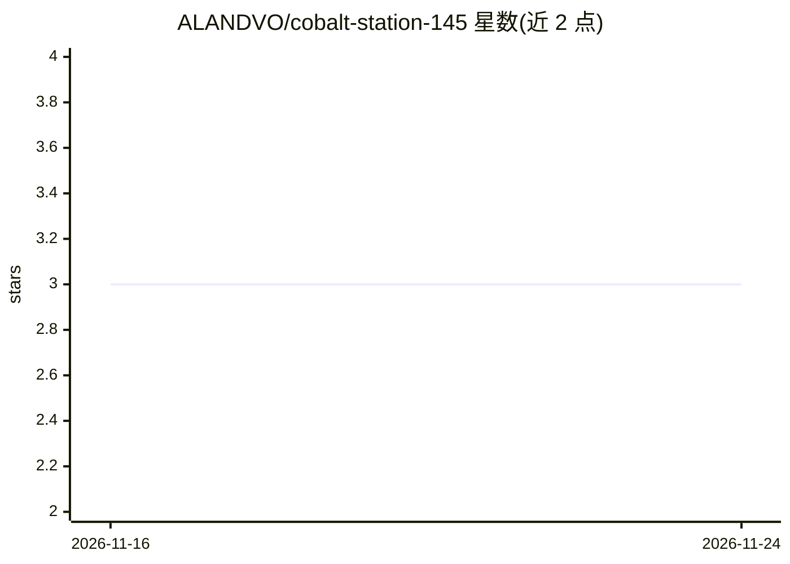

# ALANDVO/cobalt-station-145

⭐ — · [GitHub]() · 个人维护

**自托管多用户多 Agent AI 助手平台**

一个处于开发中（WIP）的自托管 AI 助手项目，版本 1.4.0，基于 FastAPI 构建。README 声明的关键机制包括：每个 Agent 在独立沙箱工作区中运行，路径穿越（../）与工作区外绝对路径访问会被 WorkspaceAccessError 阻断；支持多用户隔离与预配置专家角色；通过 MCP 将记忆系统暴露给外部 AI 客户端；存储支持 PostgreSQL/SQLite 及连接池。README 明确提示当前检查点可能不完整或测试不通过，使用前需查看 PLAN.md 与 STATUS.md。

## 筛选速览

| 维度 | 判定 | 备注 |
|---|---|---|
| AI 角色 | `ai-native` | 本体是模型或模型工具 |
| 许可风险 | `none` | — |
| 部署形态 | `library` | 以包/库形式分发 |
| 模型依赖 | — | README 未给出锁定关系 |
| 硬件要求 | — | 无带数字的原话,不猜 |
| 安装摩擦 | `low` | 无编译、无系统依赖或容器化 |
| 成熟度 | `idea` | |

## 能力要点

- Agent 工作区严格隔离：阻止路径穿越与越权文件访问
- MCP 暴露记忆系统供外部 AI 客户端调用
- 多用户隔离与预配置专家角色
- PostgreSQL/SQLite 双存储后端

## 适用场景

- 自托管一套多用户隔离的 AI 助手服务
- 为多个 Agent 分配独立沙箱工作区
- 通过 MCP 在外部 AI 客户端中接入记忆系统

## 场景标签

`AI 助手` `Agent 记忆` · 领域:Agent 开发

## 证据(README 行号)

> L7: A smarter, self-hosted AI assistant — multi-user, multi-agent.
> L11: - **Strict agent workspace isolation**: Each agent operates in its own sandboxed workspace

## 星数曲线

2026-11-16 3 → 2026-11-24 3（+0）

---
*卡片 v1 · prompt 1.4 · 生成 2026-11-22 · 置信度 mid · 依据 README sha `05a46bb98375` · [字段定义](../../DATASET.md)*
