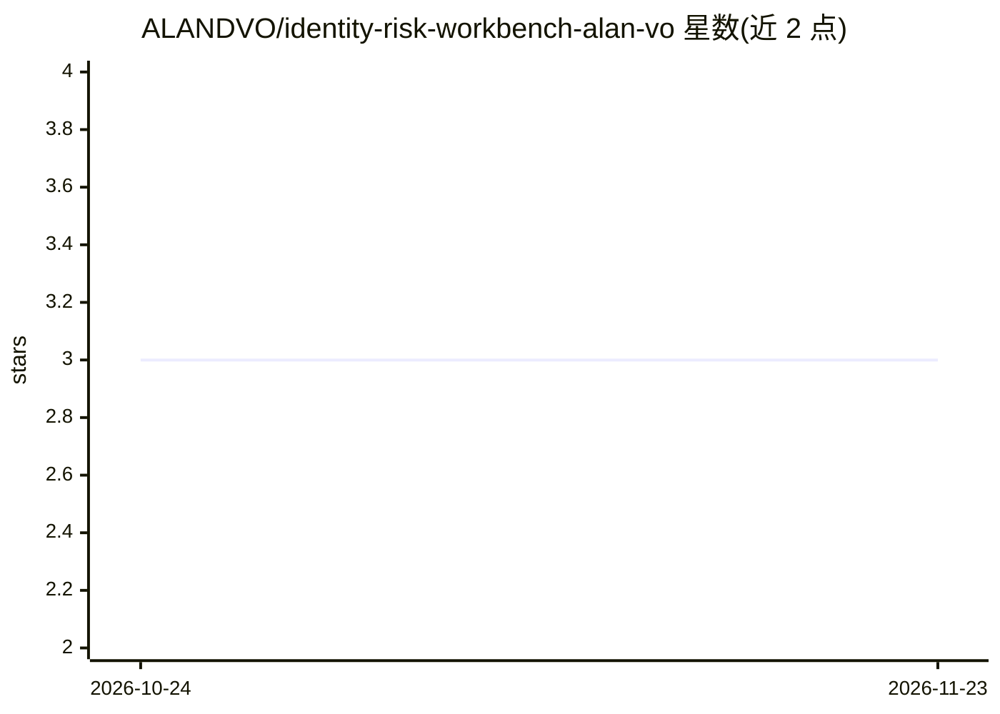

# ALANDVO/identity-risk-workbench-alan-vo

⭐ 3 · Python · MIT · 推送 2026-11-22 · [GitHub](https://github.com/ALANDVO/identity-risk-workbench-alan-vo) · 个人维护

**给身份治理审查者用的身份风险分析与整改预览工作台**

以 FastAPI、React/TypeScript、SQLite 构建的身份治理审查工作区：导入身份导出快照后，追踪嵌套组与继承角色的有效访问，调查过期账户、MFA 缺失、无主服务、毒性权限与集中授权等风险发现，整改以计划形式提出并需第二位审查者批准，计划本身不执行变更。LLM 建议为可选项，仅发送聚合计数；支持 OIDC/SAML 登录与容器部署，运行限制为单库单进程、每快照 10,000 身份等。

## 筛选速览

| 维度 | 判定 | 备注 |
|---|---|---|
| AI 角色 | `ai-enhanced` | 去掉 AI 部分产品仍成立 |
| 许可风险 | `permissive` | MIT |
| 部署形态 | `self-host` | docker 或自建部署 |
| 模型依赖 | local-ok | 支持本地模型 |
| 硬件要求 | — | 无带数字的原话,不猜 |
| 安装摩擦 | `low` | 无编译、无系统依赖或容器化 |
| 成熟度 | `idea` | |

## 能力要点

- 嵌套组与继承角色的有效访问追踪与风险发现调查
- 双人批准的受控整改预览，计划永不直接执行变更
- 可选聚合式 LLM 建议，仅发送计数不发送身份数据
- OIDC+PKCE 会话、CSRF、角色分级与有界审计记录

## 适用场景

- 导入企业身份导出并调查权限继承带来的风险发现
- 以双人批准流程预览角色移除或账户停用计划
- 在无身份提供商凭据的本地环境演示审查工作流
- 用合成基准评估不活跃阈值策略的精度与召回

## 场景标签

`网络安全` · 领域:学习与行业

## 证据(README 行号)

> L7: An identity governance review workspace: import an identity export, trace effective access through
> L104: `LLM_API_KEY` is the only credential variable. With an OpenAI key, that alone enables the default

## 星数曲线

2026-10-24 3 → 2026-11-23 3（+0）

---
*卡片 v1 · prompt 1.4 · 生成 2026-11-22 · 置信度 high · 依据 README sha `adeae410aca3` · [字段定义](../../DATASET.md)*
