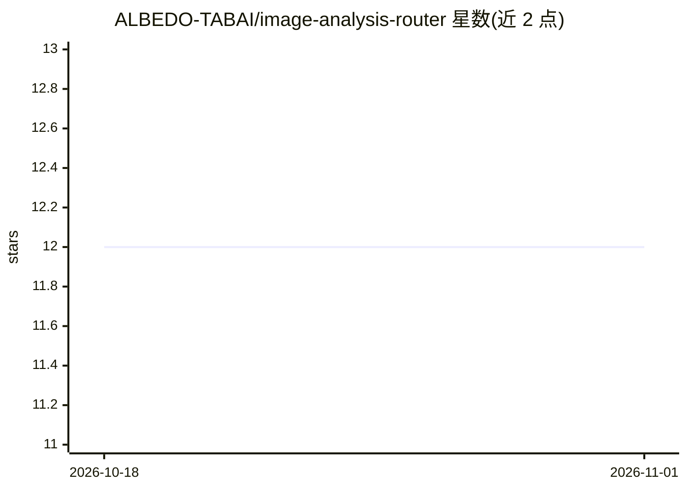

# ALBEDO-TABAI/image-analysis-router

⭐ 12 · Python · 推送 2026-05-15 · [GitHub](https://github.com/ALBEDO-TABAI/image-analysis-router) · 组织维护 · 中文 README

**为 OpenAI/Claude 类 agent 提供图像分析分流的本地 Skill**

以 SKILL.md 形式装入 agent 技能目录的图像分析技能：先通过本地 Python 脚本读取请求文本、文件名与 OCR 线索生成路由先验，将图像分入 17 条分析路线（平面设计、摄影、建筑、游戏视觉、医学影像等），再由 agent 输出路线决策、分析报告与学习报告，并标注路线置信度（high/medium/low）。需 Python 3.13+ 运行路由脚本；纯文本聊天环境支持受限；脚本输出被定位为起点而非最终答案，重要判断须回到可视证据。

## 筛选速览

| 维度 | 判定 | 备注 |
|---|---|---|
| AI 角色 | `ai-ecosystem` | LLM/agent 周边工具 |
| 许可风险 | `none` | — |
| 部署形态 | `None` |  |
| 模型依赖 | — | README 未给出锁定关系 |
| 硬件要求 | — | 无带数字的原话,不猜 |
| 安装摩擦 | `low` | 无编译、无系统依赖或容器化 |
| 成熟度 | — | 结构信号不足 |

## 能力要点

- 17 条图像分析路线覆盖设计、摄影、建筑、时尚、医学影像等领域
- 本地 route_image_request.py 依据 prompt/文件名/OCR 线索生成路由先验
- 双输出：Analysis Report 与 Study Report（练习建议）
- 路由置信度标注（high/medium/low）

## 适用场景

- 让 agent 对海报、幻灯片等图像做定向批评分析
- 批量室内渲染图/摄影作品的分析与学习建议生成
- 不确定图像类型时先跑本地路由脚本获得分析路线建议

## 场景标签

`多模态` · 领域:感知与多模态

## 证据(README 行号)

> L7: Type: OpenAI + Claude Skill
> L35: 🧩 This is a local skill for OpenAI- and Claude-based agent environments. Put the whole folder into your skill direc
> L171: 💻 This skill works best in AI agent environments that can load local skill folders and accept image input.

## 星数曲线

2026-10-18 12 → 2026-11-01 12（+0）

---
*卡片 v1 · prompt 1.4 · 生成 2026-11-01 · 置信度 high · 依据 README sha `caee20cddbe8` · [字段定义](../../DATASET.md)*
