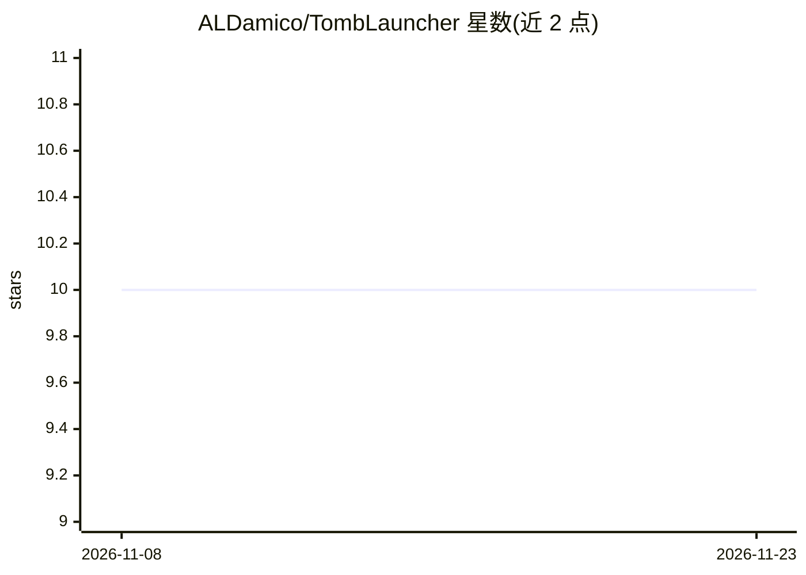

# ALDamico/TombLauncher

⭐ 10 · C# · MIT · 推送 2026-06-07 · [GitHub](https://github.com/ALDamico/TombLauncher) · [官网](https://tomblauncher.app) · 个人维护

**给 Tomb Raider 自定义关卡玩家的下载安装管理启动器**

面向 Tomb Raider 自定义关卡（TRLE/TRNG/TombEngine/TR1X/TR2X）玩家的跨平台桌面管理应用：聚合 TRLE.net、TRCustoms 等 4 个社区站的关卡搜索，一键下载并自动解压安装，提供游戏库、游玩统计、存档管理、手柄支持（AntiMicroX）、宽屏补丁、Discord 状态与 7 种语言界面。可选 AI 助手 Laura 默认关闭，需本地 LLM 后端（Ollama 或 LM Studio），基于从官网拉取的故障排除知识库回答问题，数据不出本机。

## 筛选速览

| 维度 | 判定 | 备注 |
|---|---|---|
| AI 角色 | `ai-enhanced` | 去掉 AI 部分产品仍成立 |
| 许可风险 | `permissive` | MIT |
| 部署形态 | `desktop` | 安装包/桌面程序 |
| 模型依赖 | local-ok | 支持本地模型 |
| 硬件要求 | — | 无带数字的原话,不猜 |
| 安装摩擦 | `medium` | 含编译或系统依赖之一 |
| 成熟度 | — | 结构信号不足 |

## 能力要点

- 聚合 4 个社区站点的关卡搜索与一键下载安装
- 游玩统计、存档管理与 TRNG 存档截图提取
- AI 助手 Laura 接入本地 LLM（Ollama/LM Studio），含故障排除知识库 RAG
- Windows/Linux 跨平台（Avalonia UI），支持 AppImage/DEB/RPM/安装包

## 适用场景

- 一站式搜索、下载和管理二十多年积累的社区自制关卡
- 经典引擎在现代系统上的宽屏、无边框窗口等兼容处理
- 关卡无法启动时向本地 AI 助手求助排查

## 场景标签

 · 领域:游戏/桌面工具

## 证据(README 行号)

> L12: If you've ever wanted to play fan-made Tomb Raider levels but found the process of downloading, installing, and man
> L128: ### 🤖 AI-Assisted Troubleshooting (Laura)
> L130: > **Experimental** — this feature requires a local LLM backend and is disabled by default.

## 星数曲线

2026-11-08 10 → 2026-11-23 10（+0）

---
*卡片 v1 · prompt 1.4 · 生成 2026-11-20 · 置信度 high · 依据 README sha `26c1ea3577bb` · [字段定义](../../DATASET.md)*
