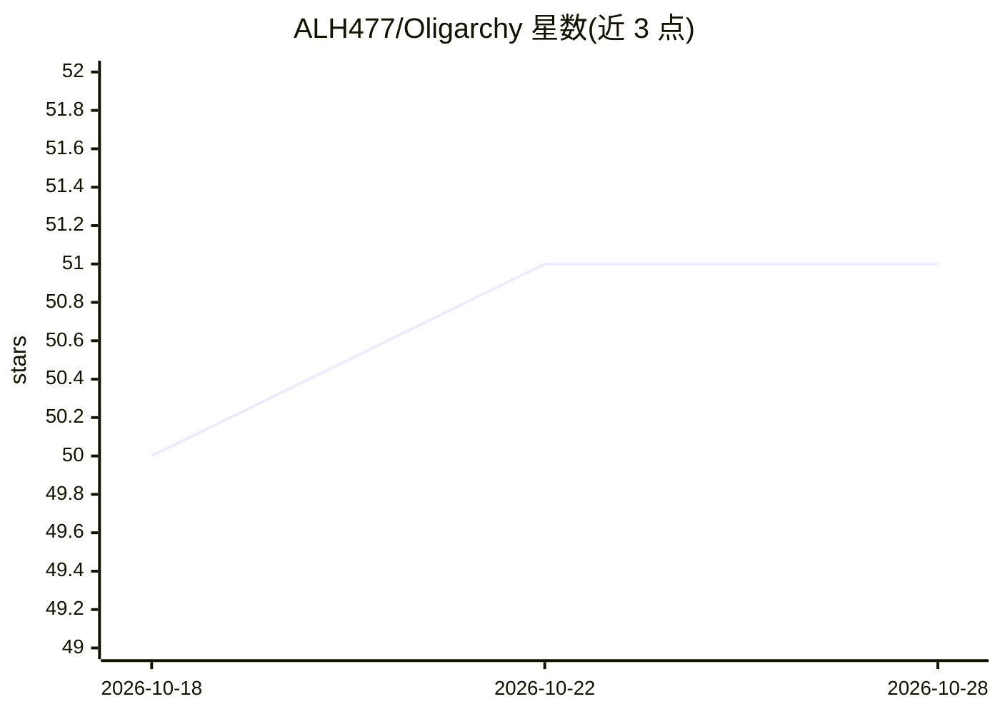

# ALH477/Oligarchy

⭐ 51 · Nix · BSD-3-Clause · 推送 2026-10-12 · [GitHub](https://github.com/ALH477/Oligarchy) · 个人维护

**个人维护的一体化 NixOS 桌面平台：实时音频/开发/游戏/本地 AI**

作者 ALH477 以 Nix flake 形式构建的可复现 NixOS 发行版，目标硬件为 Framework 16/13 等 AMD 7040 平台，含 Nvidia Optimus 支持。功能覆盖实时 DSP 协处理器（QEMU/KVM 虚拟机 + NetJack2，宣称 0.38–2.66ms 延迟）、四台专用 VM、多桌面（Hyprland/Plasma 6/IceWM/LeftWM）、本地 Ollama AI 栈（ROCm/CUDA/CPU）、本地 TTS 语音（Coqui XTTS-v2/Piper）、只读 MCP agent 接口与 P2P Nix substituter。README 主体为讽刺文体，实际细节指向 docs/architecture.md。

## 筛选速览

| 维度 | 判定 | 备注 |
|---|---|---|
| AI 角色 | `ai-enhanced` | 去掉 AI 部分产品仍成立 |
| 许可风险 | `permissive` | BSD-3-Clause |
| 部署形态 | `None` |  |
| 模型依赖 | local-ok | 支持本地模型 |
| 硬件要求 | — | 无带数字的原话,不猜 |
| 安装摩擦 | `medium` | 含编译或系统依赖之一 |
| 成熟度 | — | 结构信号不足 |

## 能力要点

- 单一 flake 产出多目标配置（AMD 7040 Framework 16/13 等）
- DSP 协处理器以 QEMU/KVM 虚拟机隔离运行，经 NetJack2 接入宿主
- 内置 Ollama AI 栈（ROCm/CUDA/CPU），附 ai-stack CLI 与预设
- 68,372 行代码跨 278 文件（35k Nix / 24k Rust / 4k Shell / 3k Kotlin）

## 适用场景

- 在 Framework 笔记本上获得可复现的开发/游戏/实时音频一体化环境
- 低延迟音频制作场景下将 DSP 隔离到专用虚拟机
- 本地运行 Ollama 模型并配合语音助手使用

## 场景标签

`语音合成` · 领域:内容生成

## 证据(README 行号)

> L103: |Host OS|Oligarchy NixOS (CachyOS/Zen/XanMod/BORE kernel, Hyprland primary, Plasma 6 optional)|
> L116: |AI Stack|Ollama + ROCm / CUDA / CPU (whichever silicon you conscript), `ai-stack` CLI, presets|

## 星数曲线

2026-10-18 50 → 2026-10-28 51（+1）

---
*卡片 v1 · prompt 1.4 · 生成 2026-10-24 · 置信度 mid · 依据 README sha `4e19e12d50a2` · [字段定义](../../DATASET.md)*
