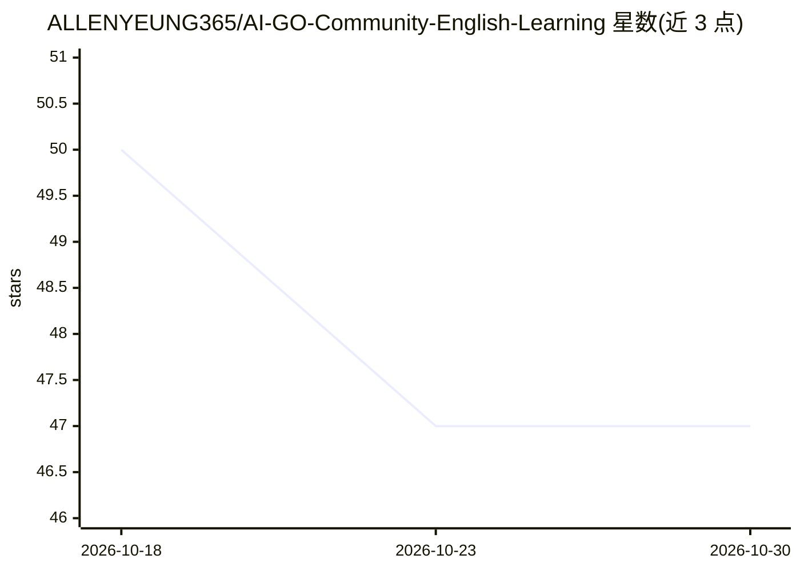

# ALLENYEUNG365/AI-GO-Community-English-Learning

⭐ 47 · TypeScript · 推送 2026-09-13 · [GitHub](https://github.com/ALLENYEUNG365/AI-GO-Community-English-Learning) · [官网](https://english-learning-circle.vercel.app) · 个人维护

**面向职业教育与终身学习者的社区英语学习平台**

基于 Next.js 15 + TypeScript + Supabase/Prisma 构建的社区型英语学习 Web 平台，理念是将练习、反馈、激励与社交互动放在同一学习生态。功能包括 Google OAuth 登录、每日打卡、积分奖励、图文视频分享、Learning Hub 与 AI 聊天助手（当前原型已实现）；语法批改、AI 会话练习、个性化学习路径等列为路线图而非已完成功能。目标用户为职业教育学生、国际学习者、英语教师与终身学习者。提供 Vercel 部署的原型与 npm 本地运行方式，MIT 许可。

## 筛选速览

| 维度 | 判定 | 备注 |
|---|---|---|
| AI 角色 | `ai-enhanced` | 去掉 AI 部分产品仍成立 |
| 许可风险 | `none` | — |
| 部署形态 | `library` | 以包/库形式分发 |
| 模型依赖 | — | README 未给出锁定关系 |
| 硬件要求 | — | 无带数字的原话,不猜 |
| 安装摩擦 | `low` | 无编译、无系统依赖或容器化 |
| 成熟度 | — | 结构信号不足 |

## 能力要点

- AI Chat Assistant 为当前原型已实现的 AI 功能
- 每日打卡、积分奖励与社区图文视频分享
- 进阶 AI 功能（语法批改/会话练习/个性化路径）列为路线图
- 完成安全加固：CodeQL、Secret Scanning、Dependabot 与主分支保护

## 适用场景

- 职业教育学生进行实用英语练习与打卡
- 国际学习者准备学术与跨文化沟通场景
- 教师用作社区导向的学习资源与参与空间
- 终身学习者通过社区互动保持练习习惯

## 场景标签

`聊天机器人` · 领域:对话与助手

## 证据(README 行号)

> L9: **AI GO Community English Learning** is a community-oriented English learning platform built around one simple idea:
> L63: - ✅ AI Chat Assistant (current prototype experience)
> L68: Advanced AI functions are presented separately as a roadmap rather than as completed features.

## 星数曲线

2026-10-18 50 → 2026-10-30 47（-3）

---
*卡片 v1 · prompt 1.4 · 生成 2026-10-25 · 置信度 high · 依据 README sha `923b0eda7040` · [字段定义](../../DATASET.md)*
