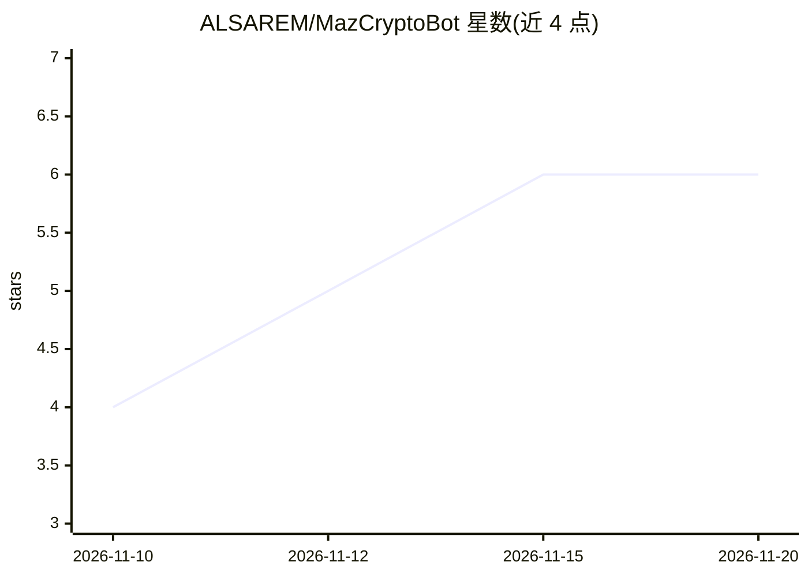

# ALSAREM/MazCryptoBot

⭐ 6 · Python · NOASSERTION · 推送 2026-11-05 · [GitHub](https://github.com/ALSAREM/MazCryptoBot) · 个人维护

**自托管加密交易实验室：夜间进化规则交易 agent 并人工晋级实盘**

自托管（source-available）的加密货币交易研究平台，由 FastAPI+SQLite+React 控制面板与多个交易系统组成：资金费率套利（经 Hummingbot）、Freqtrade 实验室、新币筛选卫星系统、LLM 观察与解释 agent，以及核心的 AI Arena——每晚回测 10 轮×5,000 个规则 agent，经回撤/过拟合检验等评审后按三阶段晋级（回测→模拟盘→带 200 EUR 硬上限与人工开关的实盘）。默认仅模拟/干跑模式；UI 与文档部分为法语；按 PolyForm Strict 许可仅限个人非商业使用。

## 筛选速览

| 维度 | 判定 | 备注 |
|---|---|---|
| AI 角色 | `ai-enhanced` | 去掉 AI 部分产品仍成立 |
| 许可风险 | `none` | NOASSERTION |
| 部署形态 | `self-host` | docker 或自建部署 |
| 模型依赖 | — | README 未给出锁定关系 |
| 硬件要求 | — | 无带数字的原话,不猜 |
| 安装摩擦 | `low` | 无编译、无系统依赖或容器化 |
| 成熟度 | — | 结构信号不足 |

## 能力要点

- AI Arena：夜间进化数千个规则 agent，含 PBO 过拟合检验与分市况评审
- 模型动物园：预训练时序基础模型（Kronos/Chronos/TiRex/CryptoBERT），跟踪训练截止防前视泄漏
- 三阶段晋级：回测→模拟盘→经人工开关的封顶实盘（200 EUR 硬上限、熔断器）
- LLM 仅做观察/变异建议/解释，策略与风控代码内无 LLM 调用，全部调用记录成本

## 适用场景

- 个人研究者搭建自有加密策略回测与模拟盘流水线
- 用进化算法批量筛选交易规则并控制过拟合
- 以人工开关+硬上限的方式小额度试验实盘交易

## 场景标签

`金融量化` `模型训练` · 领域:学习与行业

## 证据(README 行号)

> L3: **A source-available, self-hosted crypto trading lab where thousands of rule-based agents are evolved every night, j
> L5: Maz CryptoBot combines open-source trading engines (Hummingbot, Freqtrade) with a home-made control plane (FastAPI, 
> L27: |**AI-Engine**|An LLM that watches results and proposes mutations. It never places an order and every call is logge

## 星数曲线

2026-11-10 4 → 2026-11-20 6（+2）

---
*卡片 v1 · prompt 1.4 · 生成 2026-11-20 · 置信度 mid · 依据 README sha `b7f64e216260` · [字段定义](../../DATASET.md)*
