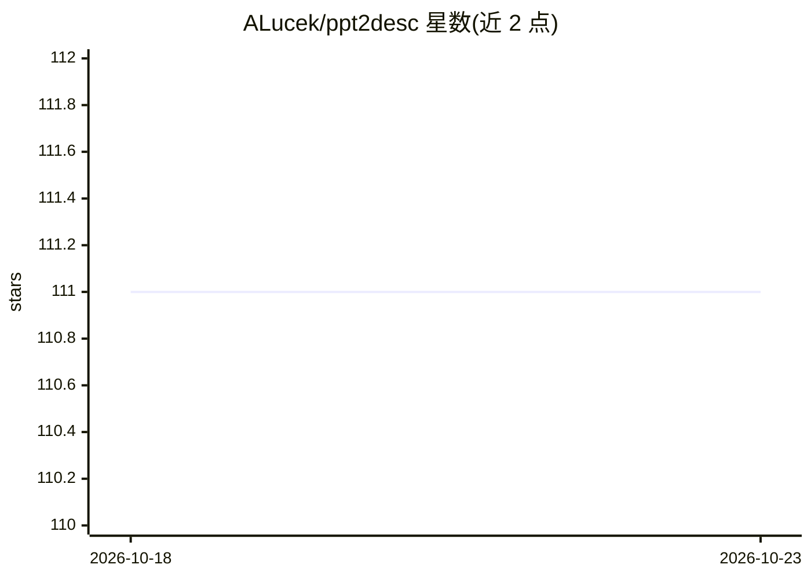

# ALucek/ppt2desc

⭐ 111 · Python · MIT · 推送 2025-11-12 · [GitHub](https://github.com/ALucek/ppt2desc) · [官网](https://lucek.ai) · 个人维护

**用视觉语言模型把 PPT 转成语义丰富文本的命令行工具**

命令行工具，将 PowerPoint 演示文稿转为详细文本描述：先用 LibreOffice 无头模式把 PPT/PPTX 转 PDF，再通过视觉语言模型逐页转录文字并解读图表等视觉元素，输出 JSON 格式结果。支持 Gemini、OpenAI、Anthropic、Vertex AI、Azure AI Foundry、AWS Bedrock 六种模型接入通道，可本地安装 LibreOffice 或使用自带 Docker 容器，提供 API 限速与自定义提示词。面向需将演示文稿转为机器可读文本的开发者。

## 筛选速览

| 维度 | 判定 | 备注 |
|---|---|---|
| AI 角色 | `ai-native` | 本体是模型或模型工具 |
| 许可风险 | `permissive` | MIT |
| 部署形态 | `self-host` | docker 或自建部署 |
| 模型依赖 | locked-api |  |
| 硬件要求 | — | 无带数字的原话,不猜 |
| 安装摩擦 | `low` | 无编译、无系统依赖或容器化 |
| 成熟度 | — | 结构信号不足 |

## 能力要点

- PPT/PPTX → PDF → 逐页语义描述的转换流程
- 6 种模型提供方接入（Gemini/OpenAI/Anthropic/Vertex AI/Azure/Bedrock）
- 解读图表、图形等视觉元素并输出 JSON
- LibreOffice 本地安装或 Docker 容器两种转换方式

## 适用场景

- 把演示文稿批量转为可检索/可分析的文本语料
- 为 LLM 管线预处理 PPT 内容
- 保存转换 PDF 与逐页图片用于归档

## 场景标签

`多模态` `文档解析` · 领域:知识与检索

## 证据(README 行号)

> L7: ppt2desc is a command-line tool that converts PowerPoint presentations into detailed textual descriptions. PowerPoin
> L19: - Gemini models via Google Gemini API

## 星数曲线

2026-10-18 111 → 2026-10-23 111（+0）

---
*卡片 v1 · prompt 1.4 · 生成 2026-10-23 · 置信度 mid · 依据 README sha `2d02b750c6b5` · [字段定义](../../DATASET.md)*
