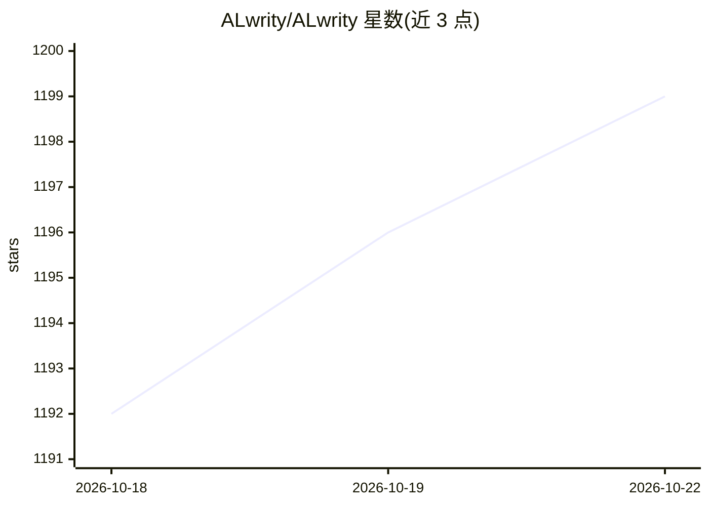

# ALwrity/ALwrity

⭐ 1,201 · Python · 推送 2026-10-05 · [GitHub](https://github.com/ALwrity/ALwrity) · [官网](https://alwrity.com) · 个人维护

**面向营销与创作者的 AI 内容生成与营销平台（内容 OS）**

开源 AI 数字营销平台（MIT，Python 3.10+/FastAPI 后端 + React 前端）：摄取网站、竞品与渠道数据构建可复用的品牌上下文（brand brain），再以 Agent 驱动的流程生成博客、故事、YouTube 视频脚本、播客大纲等多面内容。功能包括分阶段 AI 博客写作（研究→大纲→内容→SEO→发布）、视频/播客制作、SEO 仪表盘（含 Google Search Console 集成）、Google 检索落地的 LinkedIn 内容与 persona/品牌语气系统。LLM 默认 Gemini、可回退 Hugging Face，另支持 OpenAI、Anthropic、Mistral 等。README 标注 WIP，需本地克隆源码分别安装前后端运行。

## 筛选速览

| 维度 | 判定 | 备注 |
|---|---|---|
| AI 角色 | `ai-native` | 本体是模型或模型工具 |
| 许可风险 | `permissive` | — |
| 部署形态 | `library` | 以包/库形式分发 |
| 模型依赖 | — | README 未给出锁定关系 |
| 硬件要求 | — | 无带数字的原话,不猜 |
| 安装摩擦 | `low` | 无编译、无系统依赖或容器化 |
| 成熟度 | `idea` | |

## 能力要点

- 分阶段 Agent 流程：研究→大纲→内容→SEO→发布的 AI 博客写作
- Google 落地（grounding）+ 引用追踪的 LinkedIn 事实性内容生成
- 品牌 persona 系统与平台化适配（Facebook/LinkedIn 等结构化 JSON）
- LLM 提供商自动选择：默认 Gemini，HF 回退，支持多提供商

## 适用场景

- 营销人员从研究到发布一站式生成与优化博客内容
- 基于品牌语气与 persona 批量产出多平台内容
- 通过 SEO 仪表盘分析站点并对接 Google Search Console 数据

## 场景标签

`AI 写作` · 领域:内容生成

## 证据(README 行号)

> L19: - **Contextual content OS**: Ingests your website, competitors, and channels to build a reusable brand brain.
> L21: - **Agent-driven flows**: Orchestrated research, planning, writing, and optimization instead of one-off prompts.
> L41: - **AI Blog Writer (Phases)**: Research → Outline → Content → SEO → Publish, with guarded navigation and local pers

## 星数曲线

2026-10-18 1,192 → 2026-10-22 1,199（+7）

---
*卡片 v1 · prompt 1.4 · 生成 2026-10-21 · 置信度 mid · 依据 README sha `0086908e0422` · [字段定义](../../DATASET.md)*
