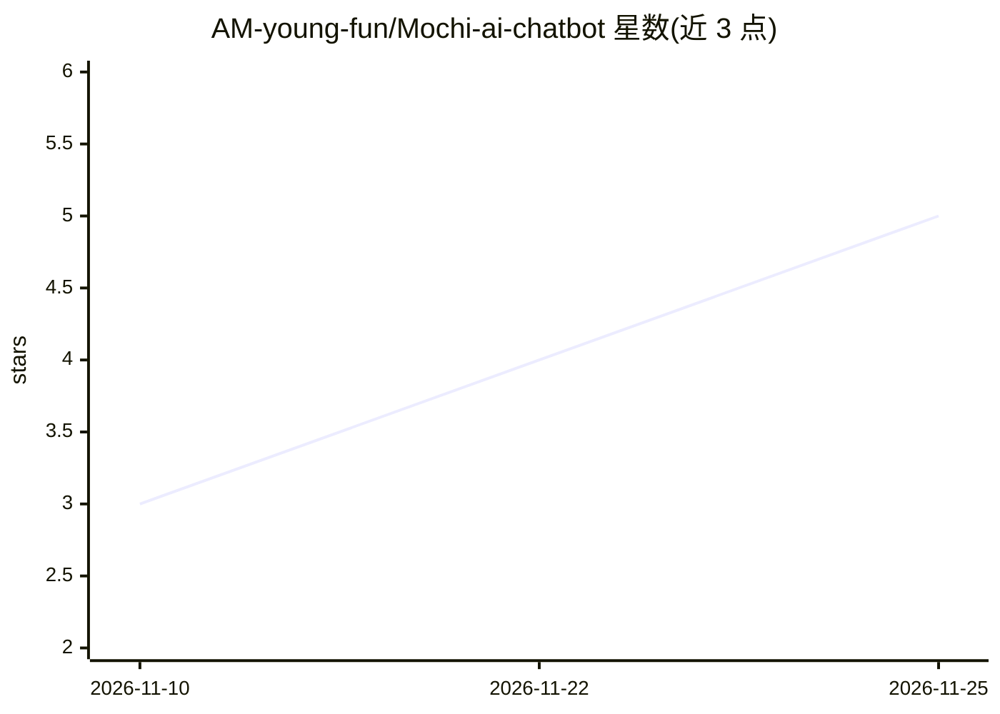

# AM-young-fun/Mochi-ai-chatbot

⭐ 5 · TypeScript · MIT · 推送 2026-11-23 · [GitHub](https://github.com/AM-young-fun/Mochi-ai-chatbot) · [官网](https://www.mochichatbot.com?utm_source=github&utm_medium=mochi) · 个人维护 · 中文 README

**自托管聊天机器人平台：为 Discord/Telegram/Slack/QQ/网站搭建 AI bot**

开源聊天机器人平台，通过一个 Flatkey API key 部署，可在仪表盘中创建多个 bot，每个 bot 有独立的 persona、知识库、渠道、记忆与每日 token 预算，无需改代码。bot 通过聊天、视觉、网页搜索与后台记忆更新等多类模型调用生成回复；知识库检索基于 SQLite 全文搜索与 trigram 索引，不调用 embedding。所有调用经 Flatkey 网关计费，仪表盘展示按 bot、能力与模型分列的用量。默认首个 bot 为群聊陪伴角色 Mochi。

## 筛选速览

| 维度 | 判定 | 备注 |
|---|---|---|
| AI 角色 | `ai-native` | 本体是模型或模型工具 |
| 许可风险 | `permissive` | MIT |
| 部署形态 | `self-host` | docker 或自建部署 |
| 模型依赖 | — | README 未给出锁定关系 |
| 硬件要求 | — | 无带数字的原话,不猜 |
| 安装摩擦 | `low` | 无编译、无系统依赖或容器化 |
| 成熟度 | — | 结构信号不足 |

## 能力要点

- 仪表盘配置多 bot：persona、知识库、渠道、记忆与每日预算
- 上传文档/粘贴文本/导入网页构建 Q&A 知识库，SQLite 全文检索无需 embedding
- 接入 Discord、Telegram、Slack、QQ 与一行代码的网站挂件
- 按能力开关、每日 token 预算与分模型用量统计做成本控制

## 适用场景

- 在群聊里部署会记住成员的陪伴型 bot
- 用自有文档搭建只依据知识库回答的 Q&A/支持 bot
- 给自己网站加一行代码的访客聊天挂件
- 按 bot 限额控制 token 花费

## 场景标签

`聊天机器人` `文档问答` · 领域:对话与助手

## 证据(README 行号)

> L20: Mochi is an open-source chatbot platform you can deploy in minutes with one Flatkey API key. Create as many bots as
> L34: A good chatbot isn't one model. Each Mochi bot uses **several kinds of model calls**: chat, vision to read images, 
> L51: |🔌|**Channels**|Connect Discord, Telegram, Slack and QQ from the dashboard. Tokens are verified with each platform 

## 星数曲线

2026-11-10 3 → 2026-11-25 5（+2）

---
*卡片 v1 · prompt 1.4 · 生成 2026-11-22 · 置信度 high · 依据 README sha `52691aac4665` · [字段定义](../../DATASET.md)*
