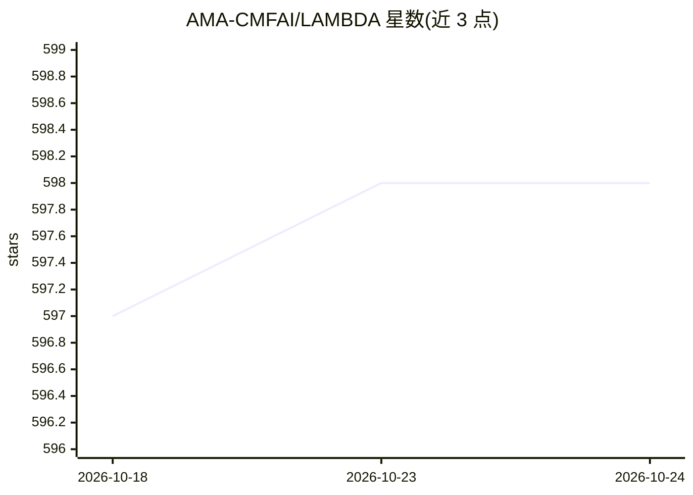

# AMA-CMFAI/LAMBDA

⭐ 598 · Python · 推送 2026-08-11 · [GitHub](https://github.com/AMA-CMFAI/LAMBDA) · [官网](https://arxiv.org/abs/2407.17535) · 组织维护 · 中文 README

**自然语言数据分析 agent：上传数据提问，自动写代码出报告**

论文 LAMBDA 的开源代码库，提供对话式数据分析 agent：上传 CSV/Excel 等数据集后，用自然语言提问，系统检查数据、编写并执行 Python/shell 代码、生成图表、总结发现并导出 Jupyter Notebook、Markdown、PDF 报告与幻灯片。由 FastAPI 后端、React 前端、OpenAI 兼容模型接口、SQLite 存储与每会话工作区组成。模型通过配置任意 OpenAI 兼容端点接入；分析代码在后端机器上执行，README 提示需在可信环境使用或自行添加沙箱隔离。

## 筛选速览

| 维度 | 判定 | 备注 |
|---|---|---|
| AI 角色 | `ai-native` | 本体是模型或模型工具 |
| 许可风险 | `none` | — |
| 部署形态 | `library` | 以包/库形式分发 |
| 模型依赖 | — | README 未给出锁定关系 |
| 硬件要求 | — | 无带数字的原话,不猜 |
| 安装摩擦 | `low` | 无编译、无系统依赖或容器化 |
| 成熟度 | — | 结构信号不足 |

## 能力要点

- 自然语言驱动数据分析，agent 编写并执行 Python/shell 代码
- 自主探索模式：自动检查数据、规划分析、产出报告
- 导出 Jupyter Notebook、Markdown、PDF 报告与幻灯片
- 任意 OpenAI 兼容模型端点可配置，本地 SQLite 存储会话与产物

## 适用场景

- 上传数据集后用自然语言提问获得分析与可视化
- 让 agent 自主完成从数据探索到报告生成的全流程
- 中英文环境下生成可复现的分析 notebook 与报告

## 场景标签

`数据分析` · 领域:效率与自动化

## 证据(README 行号)

> L18: LAMBDA is a data analysis agent that turns natural-language questions into
> L19: reproducible analysis workflows. Upload a dataset, ask a question, and LAMBDA
> L23: The public web app is available at **https://lambda.com.ai**. This repository

## 星数曲线

2026-10-18 597 → 2026-10-24 598（+1）

---
*卡片 v1 · prompt 1.4 · 生成 2026-10-21 · 置信度 mid · 依据 README sha `df71daf36d6a` · [字段定义](../../DATASET.md)*
