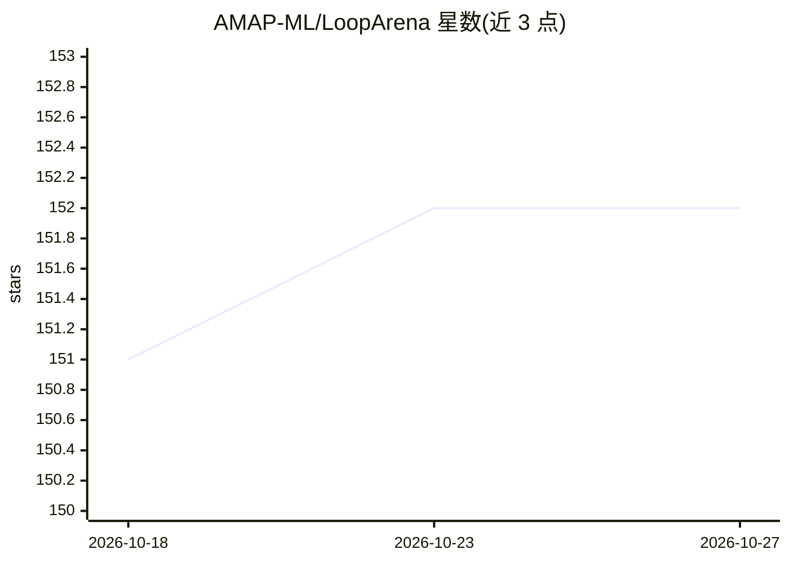

# AMAP-ML/LoopArena

⭐ 152 · Python · Apache-2.0 · 推送 2026-10-15 · [GitHub](https://github.com/AMAP-ML/LoopArena) · [官网](https://amap-ml.github.io/LoopArena/) · 组织维护 · 中文 README

**评测模型作为 coding agent 运行时控制器的基准（三类设置）**

LoopArena 评估模型在编码任务循环中担任运行时 Controller 的能力：Controller 审查进度、分派下一步、请求验证并决定何时停止，Worker 与只读 Reporter 由共享模型（Qwen3.7-Plus）担任。提供 Type I（160 道合同选择题）、Type II（80 个压缩编码任务）、Type III（80 个完整任务）三种设置，任务来自 SCBench、BeyondSWE、LoopsBench，使用源原生终端评测与严格成功率指标。Python 3.10+，pip 安装并配置 OpenAI 兼容端点；Type II/III 需固定任务数据、工作区与 Docker 运行时。Apache-2.0 许可。

## 筛选速览

| 维度 | 判定 | 备注 |
|---|---|---|
| AI 角色 | `ai-ecosystem` | LLM/agent 周边工具 |
| 许可风险 | `permissive` | Apache-2.0 |
| 部署形态 | `self-host` | docker 或自建部署 |
| 模型依赖 | — | README 未给出锁定关系 |
| 硬件要求 | — | 无带数字的原话,不猜 |
| 安装摩擦 | `low` | 无编译、无系统依赖或容器化 |
| 成熟度 | — | 结构信号不足 |

## 能力要点

- 三类评测设置：160 道 Type I 选择题与 80 对 Type II/III 编码任务
- Controller–Worker–Reporter 角色协议，共享 Worker 与预算的受控对比
- 源原生终端评测与 Strict Success Rate 指标
- 对 6 个 Controller 模型给出主面板结果与成本估计

## 适用场景

- 对比不同模型作为编码 agent 运行时控制器的表现
- 研究循环工程中控制决策（分派/验证/停止）的评测
- 复现或扩展带预算约束的编码 agent 基准实验

## 场景标签

`模型评测` · 领域:评测与运维

## 证据(README 行号)

> L14: **LoopArena** evaluates models as runtime Controllers of a separate coding
> L31: |Setting|Controller task|Scope|Size|Metric|
> L77: python -m pip install -e '.[gateway]'

## 星数曲线

2026-10-18 151 → 2026-10-27 152（+1）

---
*卡片 v1 · prompt 1.4 · 生成 2026-10-23 · 置信度 mid · 依据 README sha `941553c50f90` · [字段定义](../../DATASET.md)*
