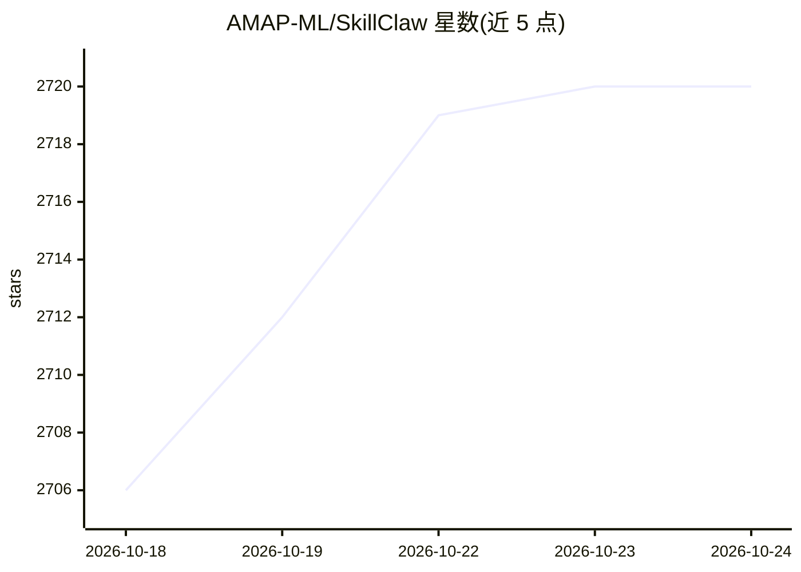

# AMAP-ML/SkillClaw

⭐ 2,720 · Python · MIT · 推送 2026-10-21 · [GitHub](https://github.com/AMAP-ML/SkillClaw) · 组织维护 · 中文 README

**让 LLM agent 技能跨会话/设备/用户持续演进的代理与进化服务**

由客户端代理与可选的 Evolve Server 组成：本地代理拦截 /v1/chat/completions 与 /v1/messages 请求，记录会话数据并管理本地技能库；Evolve Server 从共享存储读取会话数据，经 workflow（3 阶段 LLM 流水线）或 agent（OpenClaw 驱动）两种引擎生成/演进技能，以 SKILL.md 格式写回。技能可在多 agent、多设备、多用户间合并去重共享。原生集成 Hermes、Codex、Claude Code、OpenClaw 等，需 Python>=3.10 与 OpenAI 兼容 API 或 AWS Bedrock；支持 OSS/S3/本地文件系统存储。

## 筛选速览

| 维度 | 判定 | 备注 |
|---|---|---|
| AI 角色 | `ai-ecosystem` | LLM/agent 周边工具 |
| 许可风险 | `permissive` | MIT |
| 部署形态 | `library` | 以包/库形式分发 |
| 模型依赖 | — | README 未给出锁定关系 |
| 硬件要求 | — | 无带数字的原话,不猜 |
| 安装摩擦 | `low` | 无编译、无系统依赖或容器化 |
| 成熟度 | — | 结构信号不足 |

## 能力要点

- 客户端代理拦截 OpenAI 兼容 API 请求并记录会话数据
- 两种技能进化引擎：workflow 固定 3 阶段流水线与 OpenClaw agent 工作区
- 跨 agent/设备/用户共享技能库，支持合并与去重
- 支持 Hermes/Codex/Claude Code/OpenClaw 等多种 CLI agent 集成

## 适用场景

- 单个 agent 用户自动整理、去重并改进本地技能库
- 团队多成员经验汇入同一技能进化环，共享演进成果
- 多设备多 agent 实例统一技能库

## 场景标签

`Agent 记忆` · 领域:Agent 开发

## 证据(README 行号)

> L86: SkillClaw makes LLM agents progressively better by **evolving reusable skills** from real session data. A single us
> L92: 2. **Evolve Server** (`evolve_server`) — An optional service that reads session data from shared storage, evolves o

## 星数曲线

2026-10-18 2,706 → 2026-10-24 2,720（+14）

---
*卡片 v1 · prompt 1.4 · 生成 2026-10-21 · 置信度 mid · 依据 README sha `aae01ecfb5bc` · [字段定义](../../DATASET.md)*
