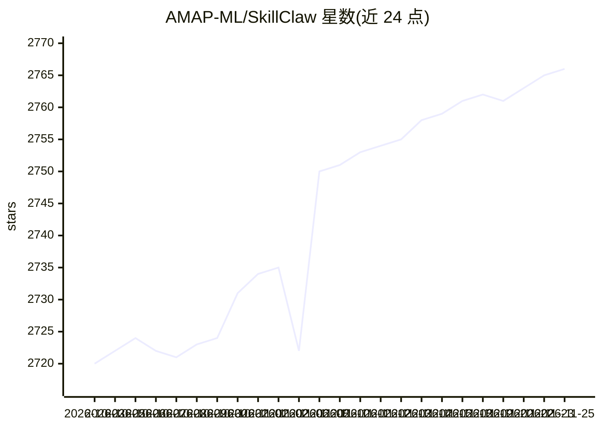

# AMAP-ML/SkillClaw

⭐ 2,766 · Python · MIT · 推送 2026-10-21 · [GitHub](https://github.com/AMAP-ML/SkillClaw) · 组织维护 · 中文 README

**为 LLM agent 用户提供从会话数据中持续演化的技能库工具**

由本地代理与可选演化服务组成的技能演化系统：本地 API 代理（/v1/chat/completions、/v1/messages）拦截 agent 请求、记录会话产物并管理本地技能库；演化服务读取共享存储中的会话数据，经 workflow（三阶段 LLM 管线）或 agent（OpenClaw 工作区）两种引擎演化或生成技能，写回统一存储。客户端与服务端通过共享存储（OSS/S3/本地）解耦，支持单用户、多设备、多 agent 与团队共享场景。通过 shell 脚本或 pip 从源码安装，提供 skillclaw setup/start/doctor 等命令行工具与双语 dashboard。

## 筛选速览

| 维度 | 判定 | 备注 |
|---|---|---|
| AI 角色 | `ai-ecosystem` | LLM/agent 周边工具 |
| 许可风险 | `permissive` | MIT |
| 部署形态 | `library` | 以包/库形式分发 |
| 模型依赖 | — | README 未给出锁定关系 |
| 硬件要求 | — | 无带数字的原话,不猜 |
| 安装摩擦 | `low` | 无编译、无系统依赖或容器化 |
| 成熟度 | — | 结构信号不足 |

## 能力要点

- 本地 API 代理拦截 agent 请求并记录会话产物，管理 SKILL.md 技能库
- 演化服务支持 workflow 与 agent（OpenClaw 驱动）两种引擎
- 多 agent/多设备技能合并、去重并统一分发
- 共享存储经 OSS/S3/本地文件系统实现团队级技能共享

## 适用场景

- 多个 agent 实例共享并统一一份技能库
- 团队将成员真实经验汇入同一演化循环
- 单用户本地为 Hermes 等客户端代理自动沉淀技能

## 场景标签

`Agent 记忆` · 领域:Agent 开发

## 证据(README 行号)

> L90: 1. **Client Proxy** — A local API proxy (`/v1/chat/completions`, `/v1/messages`) that intercepts agent requests, re
> L86: SkillClaw makes LLM agents progressively better by **evolving reusable skills** from real session data. A single us
> L32:  Natively integrates with Hermes, Codex, Claude Code, OpenClaw, QwenPaw, IronClaw, PicoClaw, ZeroClaw, NanoClaw, Ne

## 星数曲线

2026-10-23 2,720 → 2026-11-25 2,766（+46）

---
*卡片 v1 · prompt 1.4 · 生成 2026-11-23 · 置信度 mid · 依据 README sha `022ce21603b1` · [字段定义](../../DATASET.md)*
