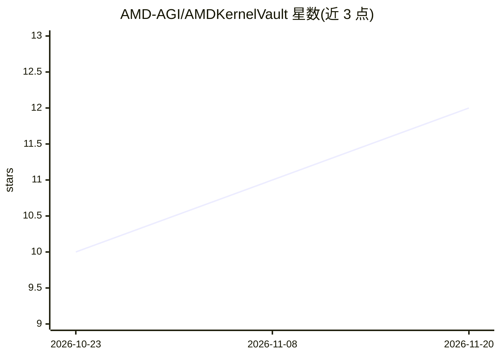

# AMD-AGI/AMDKernelVault

⭐ 12 · Python · Apache-2.0 · 推送 2026-10-07 · [GitHub](https://github.com/AMD-AGI/AMDKernelVault) · 组织维护

**AMD GPU 上训练 LLM 生成/优化 HIP 与 Triton 内核的框架**

面向 HIP 与 Triton GPU 内核任务的 LLM 训练工程仓库，按三个阶段组织：持续预训练（HIP 领域语料适配）、监督微调（代码生成/调试/优化指令行为）、强化学习（以正确性、可编译性、性能为奖励），并附内核数据生成与评测工具（PyTorch 模块转函数、PyTorch 转 HIP、HIP 内核到内核优化、Triton 生成与正确性/延迟验证）。训练数据托管在 Hugging Face 单独下载；基于 LLaMA-Factory、veRL、Slime 等栈搭建，RL 配套评测服务器与多卡（MI300X/MI325X）训练脚本。

## 筛选速览

| 维度 | 判定 | 备注 |
|---|---|---|
| AI 角色 | `ai-ecosystem` | LLM/agent 周边工具 |
| 许可风险 | `permissive` | Apache-2.0 |
| 部署形态 | `library` | 以包/库形式分发 |
| 模型依赖 | — | README 未给出锁定关系 |
| 硬件要求 | — | 无带数字的原话,不猜 |
| 安装摩擦 | `low` | 无编译、无系统依赖或容器化 |
| 成熟度 | `idea` | |

## 能力要点

- 覆盖 CPT/SFT/RL 三阶段训练流水线及配套脚本与 YAML
- HIP 内核数据生成工具包（pip 可安装的多个子包）
- RL 阶段提供 veRL 奖励代码与 HIP 评测服务器
- Triton 生成工作流含 AMD 正确性与延迟反馈验证

## 适用场景

- 在 MI300X 等 AMD GPU 上做内核生成模型的强化学习训练
- 为 HIP 内核任务构建 SFT 指令数据
- 生成并验证 PyTorch 到 HIP/Triton 的内核代码

## 场景标签

`代码生成` `模型评测` `微调` `模型训练` · 领域:编码与开发

## 证据(README 行号)

> L5: > An LLM training framework for HIP and Triton kernel generation, covering continued pretraining, supervised fine-tu
> L7: `AMDKernelVault` is a repository for training and evolving LLMs toward HIP and Triton kernel generation, understandi
> L181: - `cpt/` and `sft/` provide LLaMA-Factory based launchers and training YAMLs.

## 星数曲线

2026-10-23 10 → 2026-11-20 12（+2）

---
*卡片 v1 · prompt 1.4 · 生成 2026-11-19 · 置信度 high · 依据 README sha `cdab966a80d1` · [字段定义](../../DATASET.md)*
