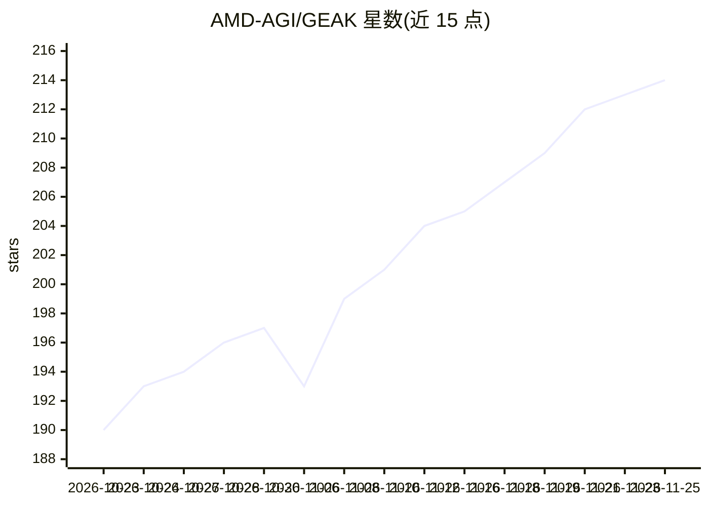

# AMD-AGI/GEAK

⭐ 214 · Python · Apache-2.0 · 推送 2026-11-23 · [GitHub](https://github.com/AMD-AGI/GEAK) · 组织维护

**AMD GPU 内核自动优化 agent：自动寻找瓶颈并生成调优内核**

GEAK 是运行在 Claude Code 之上的多 agent 优化系统，面向 AMD Instinct MI 与 RDNA 系列 GPU：用户提供单个内核或运行中的 sglang/vLLM 推理服务，agent 自动完成性能剖析、热点内核定位、跨 Triton/HIP/FlyDSL/TileLang 等路径生成与调优候选、以及在真实系统上验证加速。工作流控制流为确定性 JS 编排，LLM 仅承担判断类任务；自带可跨运行积累的知识库。要求 ROCm 6+、profiler 与预置好的内核工具链，GEAK 本身不安装内核工具链。

## 筛选速览

| 维度 | 判定 | 备注 |
|---|---|---|
| AI 角色 | `ai-ecosystem` | LLM/agent 周边工具 |
| 许可风险 | `permissive` | Apache-2.0 |
| 部署形态 | `library` | 以包/库形式分发 |
| 模型依赖 | local-ok | 支持本地模型 |
| 硬件要求 | — | 无带数字的原话,不猜 |
| 安装摩擦 | `low` | 无编译、无系统依赖或容器化 |
| 成熟度 | — | 结构信号不足 |

## 能力要点

- 两个工作流：e2e_workflow 优化整模型 sglang/vLLM 吞吐，kernel_workflow 优化单个 GPU 内核
- 确定性 JS 工作流编排控制流，LLM agent 仅负责分析、策略与优化判断
- 每次运行生成 final_report.md 及各阶段产物，改动以可回退 overlay 方式应用
- 另支持在 OpenAI codex CLI 上以相同 JS 工作流运行

## 适用场景

- 为 AMD GPU 上的 LLM 推理服务自动提升端到端吞吐
- 批量优化一组 Triton/HIP 内核并自动验证加速
- 在 MI300X 等 Instinct 卡上替代数周的人工内核调优流程

## 场景标签

`多智能体` `编码 Agent` `工作流自动化` · 领域:Agent 开发

## 证据(README 行号)

> L7: GEAK is an autonomous optimization agent that makes AMD GPUs run faster, automatically. Built as a
> L19: other gfx1100 board is refused. It is driven by
> L182: Control flow — the budget loop, fan-out, verification, and stop conditions — is **deterministic JS** in

## 星数曲线

2026-10-23 190 → 2026-11-25 214（+24）

---
*卡片 v1 · prompt 1.4 · 生成 2026-11-25 · 置信度 mid · 依据 README sha `82f6968e50a3` · [字段定义](../../DATASET.md)*
