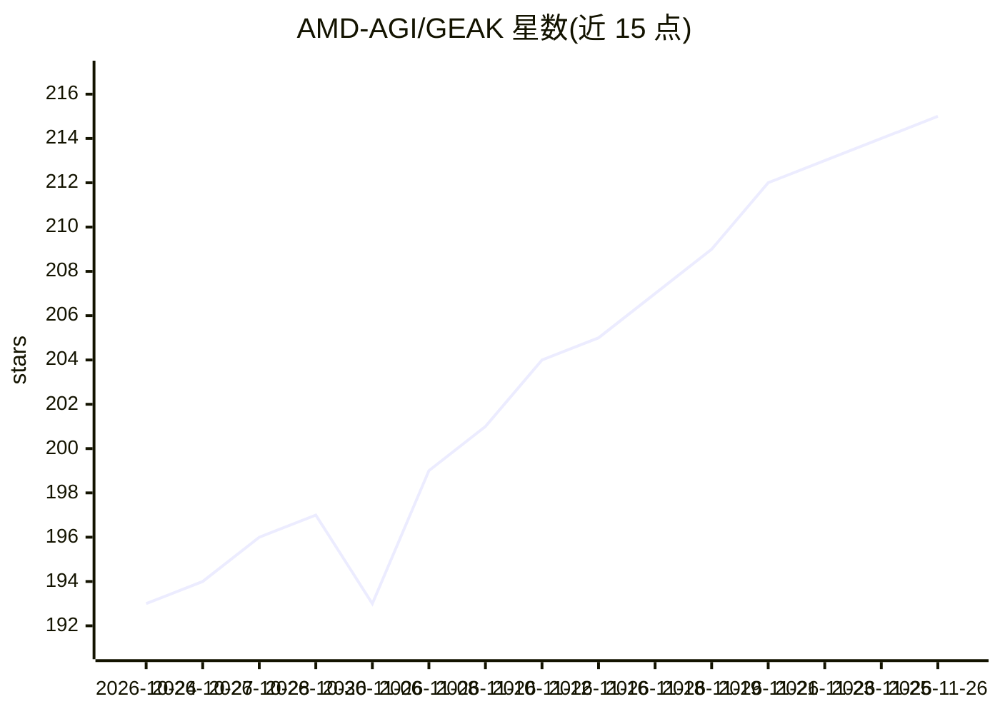

# AMD-AGI/GEAK

⭐ 215 · Python · Apache-2.0 · 推送 2026-11-25 · [GitHub](https://github.com/AMD-AGI/GEAK) · 组织维护

**面向 AMD GPU 的自主内核优化 Agent，自动提速推理栈**

GEAK 是一个多 Agent 自主优化系统，面向 AMD GPU 内核与推理服务栈：定位瓶颈、在 Triton/HIP/FlyDSL/TileLang 等路径上生成并调优内核、在真实系统上验证加速。提供两个工作流——e2e_workflow 优化整模型 sglang/vLLM 服务吞吐，kernel_workflow 优化单个内核；控制流由确定性 JS 编排，LLM 仅承担判断类任务，每轮输出完整报告。运行依赖 Claude Code（也支持 codex CLI），用户需自行准备内核工具链环境。

## 筛选速览

| 维度 | 判定 | 备注 |
|---|---|---|
| AI 角色 | `ai-native` | 本体是模型或模型工具 |
| 许可风险 | `permissive` | Apache-2.0 |
| 部署形态 | `library` | 以包/库形式分发 |
| 模型依赖 | local-ok | 支持本地模型 |
| 硬件要求 | — | 无带数字的原话,不猜 |
| 安装摩擦 | `low` | 无编译、无系统依赖或容器化 |
| 成熟度 | — | 结构信号不足 |

## 能力要点

- 两个工作流：整模型服务吞吐优化与单内核优化，可递归调用
- 确定性 JS 工作流编排，LLM 仅用于判断类决策
- 支持 AMD Instinct MI（CDNA）、RDNA3.5、RDNA4 等多代硬件，自动检测
- 批量模式每内核一个 Agent，GPU 访问经 flock 锁串行化

## 适用场景

- 提升整个 LLM 在 sglang/vLLM 上的服务吞吐
- 优化单个 AMD GPU 内核的延迟与加速比
- 在 AMD MI300X 等卡上自动化原本需专家数周的内核调优
- 用 recorded trace 回放的方式按真实请求分布做优化

## 场景标签

`多智能体` `编码 Agent` · 领域:Agent 开发

## 证据(README 行号)

> L7: GEAK is an autonomous optimization agent that makes AMD GPUs run faster, automatically. Built as a
> L20: Claude Code and orchestrated by deterministic JS Workflows. It ships two workflows, each for a different scenario:
> L104: `e2e_workflow/` raises the **sglang / vLLM serving throughput** of a whole LLM. It is a *system layer*

## 星数曲线

2026-10-24 193 → 2026-11-26 215（+22）

---
*卡片 v1 · prompt 1.4 · 生成 2026-11-26 · 置信度 mid · 依据 README sha `a3ea6a707913` · [字段定义](../../DATASET.md)*
