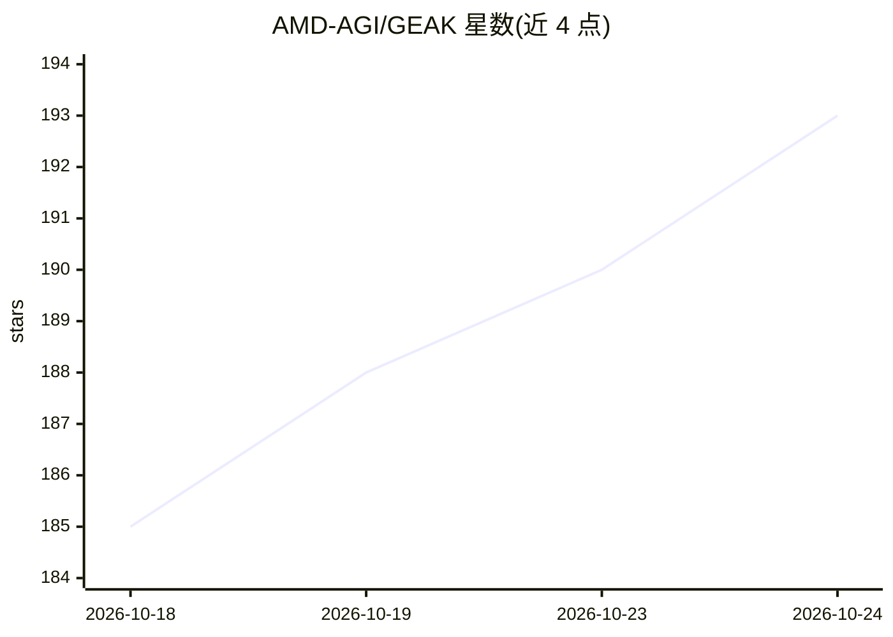

# AMD-AGI/GEAK

⭐ 193 · Python · Apache-2.0 · 推送 2026-10-23 · [GitHub](https://github.com/AMD-AGI/GEAK) · 组织维护

**面向 AMD GPU 的自动内核优化 agent，提升 vLLM/sglang 推理吞吐**

由 Claude Code 驱动的多 agent 自动优化系统，用于 AMD GPU（Instinct MI/CDNA、RDNA3.5、Radeon AI PRO R9700）内核优化。提供两条工作流：kernel_workflow 优化单个内核（Triton/HIP/CK/FlyDSL），e2e_workflow 提升整个 LLM 在 sglang/vLLM 上的服务吞吐，按 Amdahl 分诊热点内核并以温服务器 A/B 门控接受改动。控制流为确定性 JS，LLM agent 仅做判断；也可运行于 codex CLI。需先自建内核工具链（PyTorch/Triton 等）与 ROCm 6+ 环境。

## 筛选速览

| 维度 | 判定 | 备注 |
|---|---|---|
| AI 角色 | `ai-ecosystem` | LLM/agent 周边工具 |
| 许可风险 | `permissive` | Apache-2.0 |
| 部署形态 | `library` | 以包/库形式分发 |
| 模型依赖 | local-ok | 支持本地模型 |
| 硬件要求 | — | 无带数字的原话,不猜 |
| 安装摩擦 | `low` | 无编译、无系统依赖或容器化 |
| 成熟度 | — | 结构信号不足 |

## 能力要点

- kernel_workflow：Director→TechLead→专家工程师的多轮预算控制单内核优化
- e2e_workflow：Amdahl 分诊 + 交错 A/B 门控提升整模型服务吞吐
- 确定性 JS 工作流编排，LLM agent 仅承担分析/策略判断
- 支持 Claude Code 与 codex CLI 两种 agent 后端

## 适用场景

- 优化 AMD GPU 上单个 Triton/HIP 内核的延迟
- 提升 sglang/vLLM 部署的整模型推理吞吐
- 对大量内核批量派发 agent 并隔离 GPU 资源

## 场景标签

`多智能体` `编码 Agent` · 领域:Agent 开发

## 证据(README 行号)

> L7: GEAK is an autonomous optimization agent that makes AMD GPUs run faster, automatically. Built as a
> L9: improves its strategies over time. Point it at a single kernel or a live model-serving stack such as vLLM or
> L22: |e2e_workflow|Whole-model serving|End-to-end sglang / vLLM throughput of a full LLM|

## 星数曲线

2026-10-18 185 → 2026-10-24 193（+8）

---
*卡片 v1 · prompt 1.4 · 生成 2026-10-23 · 置信度 mid · 依据 README sha `5ea32adcc03c` · [字段定义](../../DATASET.md)*
