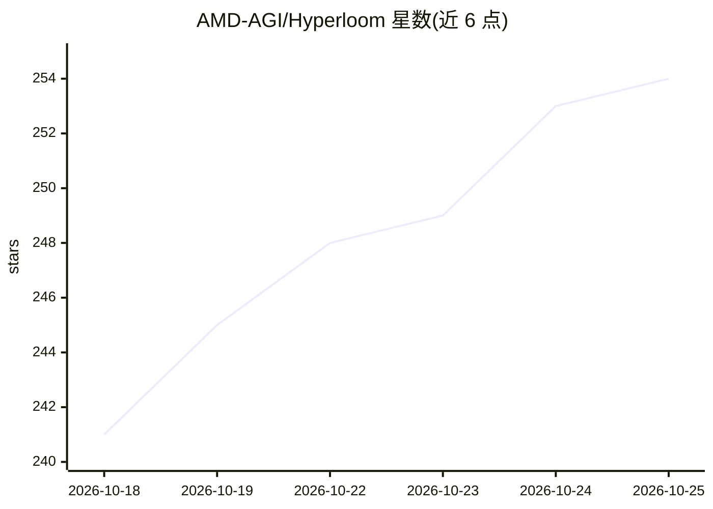

# AMD-AGI/Hyperloom

⭐ 254 · Python · NOASSERTION · 推送 2026-10-24 · [GitHub](https://github.com/AMD-AGI/Hyperloom) · [官网](https://rocm.docs.amd.com/projects/hyperloom) · 组织维护

**在 AMD Instinct GPU 上自动优化 LLM 推理的多 Agent 系统**

ROCm Hyperloom 是面向 AMD Instinct GPU（MI300X/MI325X/MI355X）的推理优化多 Agent harness：以 input→optimize→validate→learn 闭环运行，Profile 基线、搜索服务框架配置与 GPU kernel 优化、端到端验证后写入 recipe 知识库供后续会话热启动。支持 vLLM、SGLang、xDiT 上的文本生成、图像生成与自定义流水线；kernel 后端为 GEAK 或 KernelForge（单选），LLM 后端为 Claude 或 Codex。基准由协调者执行而非模型自判，失败改动回滚。以 Python 包与 CLI（hyperloom 命令）形式提供，需 ROCm 环境。

## 筛选速览

| 维度 | 判定 | 备注 |
|---|---|---|
| AI 角色 | `ai-ecosystem` | LLM/agent 周边工具 |
| 许可风险 | `permissive` | NOASSERTION |
| 部署形态 | `None` |  |
| 模型依赖 | local-ok | 支持本地模型 |
| 硬件要求 | — | 无带数字的原话,不猜 |
| 安装摩擦 | `low` | 无编译、无系统依赖或容器化 |
| 成熟度 | — | 结构信号不足 |

## 能力要点

- 闭环优化流程：基线测量→框架/内核搜索→端到端验证→recipe 知识库回写
- 支持 vLLM/SGLang/xDiT，kernel 语言 HIP/Triton/FlyDSL
- 多 Agent 架构：Coordinator（Orchestration/Critic）+ 临时 Specialist，源码修改经隔离 worktree 与统一 diff 门控
- 附计算分区扫描与 BIOS/BMC 平台调优审计脚本

## 适用场景

- 我在 MI300X 等 AMD GPU 上部署 LLM 服务，想自动调优吞吐与延迟
- 减少每个新模型/框架版本重复的人工调优工作
- 沉淀跨会话可复用的优化配置知识库

## 场景标签

`多智能体` `推理引擎` · 领域:Agent 开发

## 证据(README 行号)

> L9: **ROCm™ Hyperloom** is a multi-agent harness that autonomously optimizes inference
> L10: on AMD Instinct™ GPUs. It profiles each workload, searches framework and kernel
> L30: unsafe patches. Hyperloom is the harness around that loop: it keeps the mission

## 星数曲线

2026-10-18 241 → 2026-10-25 254（+13）

---
*卡片 v1 · prompt 1.4 · 生成 2026-10-22 · 置信度 high · 依据 README sha `f8ae219e3e88` · [字段定义](../../DATASET.md)*
