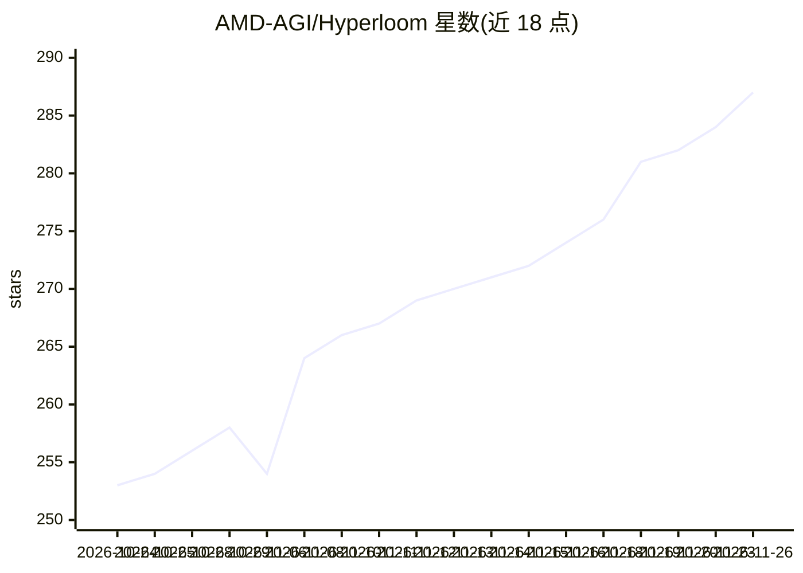

# AMD-AGI/Hyperloom

⭐ 287 · Python · NOASSERTION · 推送 2026-11-25 · [GitHub](https://github.com/AMD-AGI/Hyperloom) · [官网](https://rocm.docs.amd.com/projects/hyperloom) · 组织维护

**在 AMD GPU 上自动优化 LLM 推理负载的多智能体工具**

ROCm Hyperloom 是一个多智能体优化框架：对 AMD Instinct GPU 上的推理负载进行性能剖析、搜索服务框架与 GPU 内核层面的优化、对每个候选改动做端到端验证，并把验证通过的配置写入配方知识库供后续会话复用。支持 vLLM、SGLang、xDiT 上的文本生成、图像生成与自定义流水线；内核优化委托 GEAK 或 KernelForge 后端。平台限定 MI300X、MI325X、MI355X；基准由协调器运行而非模型判定，改动按 keep-or-revert 规则处理。

## 筛选速览

| 维度 | 判定 | 备注 |
|---|---|---|
| AI 角色 | `ai-ecosystem` | LLM/agent 周边工具 |
| 许可风险 | `permissive` | NOASSERTION |
| 部署形态 | `None` |  |
| 模型依赖 | local-ok | 支持本地模型 |
| 硬件要求 | — | 无带数字的原话,不猜 |
| 安装摩擦 | `low` | 无编译、无系统依赖或容器化 |
| 成熟度 | — | 结构信号不足 |

## 能力要点

- 多智能体闭环：input → optimize → validate → learn，带硬性循环上限
- 配方知识库按模型/硬件/框架等字段渐进放宽匹配，实现暖启动
- 风险源码改动经隔离 worktree、diff 门、策略检查与 Critic 签核
- 26 项优化已合入 vLLM/SGLang 上游（截至 2026-11-02）

## 适用场景

- 为 AMD Instinct GPU 上的 LLM 服务负载自动寻找更优推理配置
- 将内核与服务框架层面的调优改动验证后贡献回 vLLM/SGLang
- 在多模型、多框架版本迭代中复用历史优化配方

## 场景标签

`多智能体` `推理引擎` · 领域:Agent 开发

## 证据(README 行号)

> L9: **ROCm™ Hyperloom** is a multi-agent harness that autonomously optimizes inference
> L53: unsafe patches. Hyperloom is the harness around that loop: it keeps the mission
> L127: |Framework|SGLang, vLLM, xDiT|

## 星数曲线

2026-10-24 253 → 2026-11-26 287（+34）

---
*卡片 v1 · prompt 1.4 · 生成 2026-11-25 · 置信度 high · 依据 README sha `d48e65c30f04` · [字段定义](../../DATASET.md)*
