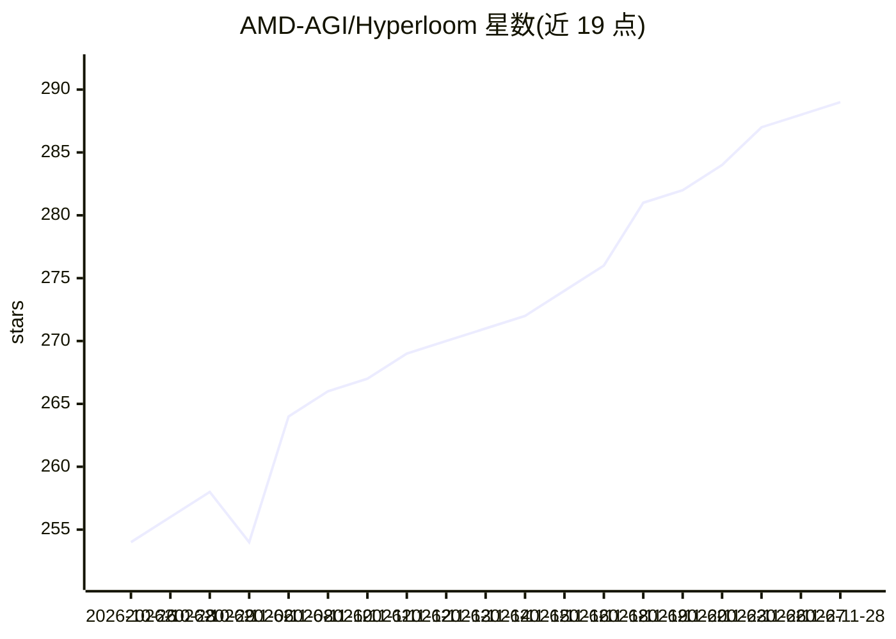

# AMD-AGI/Hyperloom

⭐ 289 · Python · NOASSERTION · 推送 2026-11-27 · [GitHub](https://github.com/AMD-AGI/Hyperloom) · [官网](https://rocm.docs.amd.com/projects/hyperloom) · 组织维护

**在 AMD GPU 上自动优化 LLM 推理负载的多 agent 工具**

面向 AMD Instinct GPU 的多 agent 优化框架：对每个推理负载先测量基线并做 roofline 分析，随后按阶段搜索服务框架参数、精度、注意力与批处理配置，并把热点 kernel 交给 GEAK 或 KernelForge 后端优化；每次变更经端到端基准验证，失败则回滚，成功结果写入 recipe 知识库供后续会话热启动。支持 vLLM、SGLang、xDiT 上的文本与图像生成负载；平台验证覆盖 MI300X、MI325X、MI355X。以 MIT 许可发布，通过 CLI 运行。

## 筛选速览

| 维度 | 判定 | 备注 |
|---|---|---|
| AI 角色 | `ai-ecosystem` | LLM/agent 周边工具 |
| 许可风险 | `permissive` | NOASSERTION |
| 部署形态 | `None` |  |
| 模型依赖 | local-ok | 支持本地模型 |
| 硬件要求 | — | 无带数字的原话,不猜 |
| 安装摩擦 | `low` | 无编译、无系统依赖或容器化 |
| 成熟度 | — | 结构信号不足 |

## 能力要点

- 闭环工作流：基线测量→优化→验证→写入 recipe 知识库
- 26 项优化已合并回上游 vLLM 与 SGLang（截至 2026-11-02）
- 框架与 kernel 两层搜索，kernel 委托 GEAK 或 KernelForge 后端
- 基准由协调器执行，agent 预测的增益不作为保留依据

## 适用场景

- 为部署在 AMD GPU 上的推理服务自动搜索更优的服务配置
- 避免每个新模型、新框架版本重复人工调优
- 积累可复用的优化 recipe，缩短后续模型的调优时间

## 场景标签

`多智能体` · 领域:Agent 开发

## 证据(README 行号)

> L9: **ROCm™ Hyperloom** is a multi-agent harness that autonomously optimizes inference
> L10: on AMD Instinct™ GPUs. It profiles each workload, searches framework and kernel
> L127: |Framework|SGLang, vLLM, xDiT|

## 星数曲线

2026-10-26 254 → 2026-11-28 289（+35）

---
*卡片 v1 · prompt 1.4 · 生成 2026-11-28 · 置信度 high · 依据 README sha `dbfce6950dd0` · [字段定义](../../DATASET.md)*
