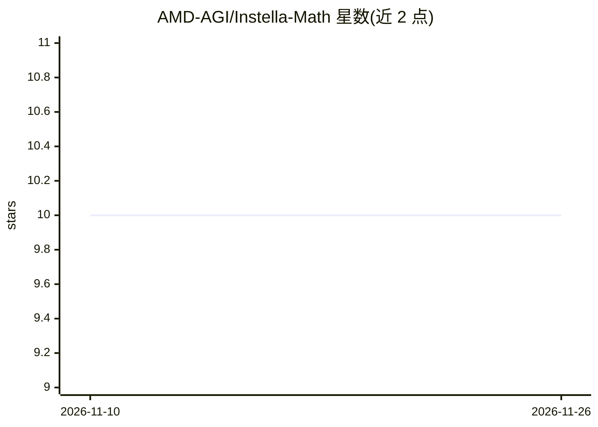

# AMD-AGI/Instella-Math

⭐ 10 · Python · NOASSERTION · 推送 2026-06-24 · [GitHub](https://github.com/AMD-AGI/Instella-Math) · 组织维护

**Instella-Math 数学推理模型的全流程训练代码**

AMD 发布的 Instella-3B-Math 模型训练代码库，覆盖两阶段数学 SFT（基于 Instella 代码库与 open-instruct，训练数据为 OpenMathInstruct-2 与 AM-DeepSeek-R1-Distilled-1.4M）、基于 VERL 的 GRPO 强化学习，以及基于 DeepScaleR 代码库的评测流程。提供数据准备脚本、torchrun/accelerate 启动脚本与 Docker 镜像构建方式；评测在 8 张 AMD Instinct MI300X GPU 上进行。模型权重采用 ResearchRAIL 许可，限学术与研究用途。

## 筛选速览

| 维度 | 判定 | 备注 |
|---|---|---|
| AI 角色 | `ai-native` | 本体是模型或模型工具 |
| 许可风险 | `none` | NOASSERTION |
| 部署形态 | `self-host` | docker 或自建部署 |
| 模型依赖 | local-ok | 支持本地模型 |
| 硬件要求 | — | 无带数字的原话,不猜 |
| 安装摩擦 | `low` | 无编译、无系统依赖或容器化 |
| 成熟度 | — | 结构信号不足 |

## 能力要点

- 两阶段数学 SFT 流程，含数据准备脚本与配置文件
- 基于 VERL 的 GRPO 强化学习，提供多节点 sbatch 启动脚本
- 基于 DeepScaleR 的评测流程，可复现测试结果
- 提供 transformers AutoModelForCausalLM 推理示例

## 适用场景

- 复现 Instella-3B-Math 的 SFT 与 GRPO 训练流程
- 在 AMD GPU（ROCm）环境搭建数学推理模型训练环境
- 运行数学基准评测并复现模型结果

## 场景标签

`模型训练` `强化学习` `模型评测` · 领域:评测与运维

## 证据(README 行号)

> L1: Instella-Math✨: Fully Open Language Model with Reasoning Capability
> L30: torchrun --nproc_per_node=8 scripts/train.py configs/instella-3b-sft-math-stage1.yaml
> L71: Our evaluations are based on the DeepScaleR codebase. All our evaluations are done on a single node with 8 AMD Inst

## 星数曲线

2026-11-10 10 → 2026-11-26 10（+0）

---
*卡片 v1 · prompt 1.4 · 生成 2026-11-20 · 置信度 high · 依据 README sha `2b3ec2579fde` · [字段定义](../../DATASET.md)*
