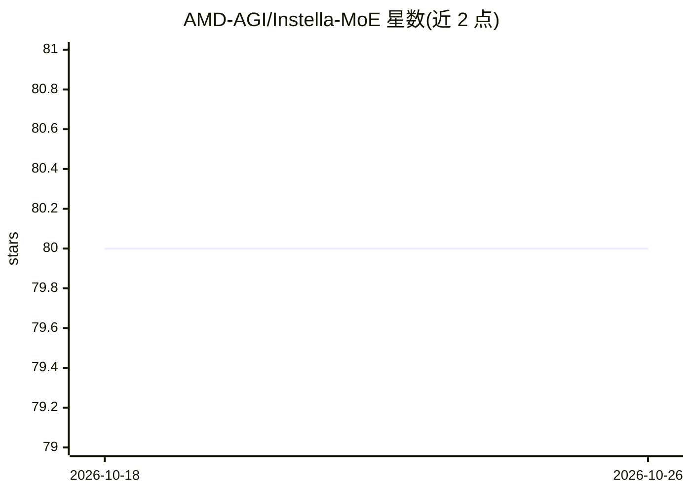

# AMD-AGI/Instella-MoE

⭐ 80 · Python · NOASSERTION · 推送 2026-09-02 · [GitHub](https://github.com/AMD-AGI/Instella-MoE) · [官网](https://rocm.blogs.amd.com/artificial-intelligence/instella-moe/README.html) · 组织维护

**AMD 开源 MoE 语言模型及全流程训练复现代码**

Instella-MoE 是 160 亿总参数、28 亿激活参数的稀疏 MoE 语言模型，在 AMD Instinct MI300X/MI325X 上用 Primus 框架从预训练训至 RL。仓库提供分阶段训练配置与启动脚本（预训练 7.1T tokens、中训、64K 长上下文、SFT、DPO、IF-RL 与多教师在线蒸馏 MOPD），推理基于 SGLang v0.5.9 的 overlay 与 FarSkip-Collective 实现，均通过 ROCm docker 镜像运行。模型以 ResearchRAIL 许可发布，限学术与研究用途。

## 筛选速览

| 维度 | 判定 | 备注 |
|---|---|---|
| AI 角色 | `ai-native` | 本体是模型或模型工具 |
| 许可风险 | `none` | NOASSERTION |
| 部署形态 | `self-host` | docker 或自建部署 |
| 模型依赖 | — | README 未给出锁定关系 |
| 硬件要求 | — | 无带数字的原话,不猜 |
| 安装摩擦 | `low` | 无编译、无系统依赖或容器化 |
| 成熟度 | — | 结构信号不足 |

## 能力要点

- 16B 总参数/2.8B 激活参数的 MoE，含 Gated MLA 与 FarSkip-Collective 结构
- 覆盖预训练到 RL（含 MOPD 蒸馏）的全流程可复现脚本与配置
- SGLang (v0.5.9) overlay 推理实现，lm-eval 评测脚本
- 提供数据准备脚本与 Hugging Face 模型集合

## 适用场景

- 在 AMD Instinct GPU 上复现模型训练各阶段
- 加载 Hugging Face checkpoint 做文本生成与评测
- 研究 MoE 训练流程（长上下文扩展、DPO、RL 蒸馏）

## 场景标签

`模型训练` · 领域:训练与推理

## 证据(README 行号)

> L3: Instella-MoE is a state-of-the-art fully open Mixture-of-Experts (MoE) language model with 16 billion total paramete
> L28: from transformers import AutoModelForCausalLM, AutoTokenizer

## 星数曲线

2026-10-18 80 → 2026-10-26 80（+0）

---
*卡片 v1 · prompt 1.4 · 生成 2026-10-24 · 置信度 high · 依据 README sha `0c416a40875f` · [字段定义](../../DATASET.md)*
