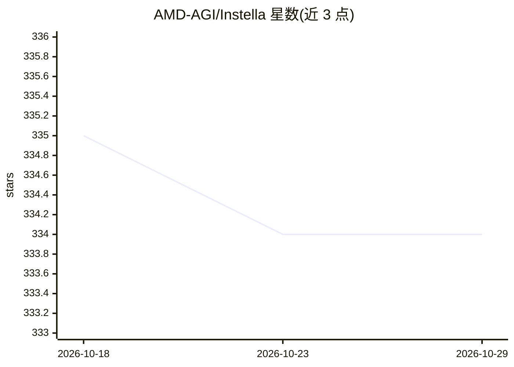

# AMD-AGI/Instella

⭐ 334 · Python · NOASSERTION · 推送 2026-05-13 · [GitHub](https://github.com/AMD-AGI/Instella) · 组织维护

**AMD 开源 3B 语言模型及完整训练代码与数据**

AMD GenAI 团队在 Instinct MI300X GPU 上训练的全开放语言模型家族：提供模型权重（预训练/SFT/Instruct 各阶段 checkpoint）、基于 OLMo 改建的 PyTorch 训练代码与两阶段预训练数据。训练流程覆盖数据准备（OLMoE-mix/dolmino-mix）、torchrun 单机多机预训练、SFT、基于 open-instruct 的 DPO，以及 GSM8k 合成数据生成。模型可经 transformers AutoModelForCausalLM 加载推理，或用 TRL CLI 终端对话。模型以 ResearchRAIL 许可发布，限学术与科研用途。

## 筛选速览

| 维度 | 判定 | 备注 |
|---|---|---|
| AI 角色 | `ai-native` | 本体是模型或模型工具 |
| 许可风险 | `none` | NOASSERTION |
| 部署形态 | `library` | 以包/库形式分发 |
| 模型依赖 | — | README 未给出锁定关系 |
| 硬件要求 | — | 无带数字的原话,不猜 |
| 安装摩擦 | `low` | 无编译、无系统依赖或容器化 |
| 成熟度 | — | 结构信号不足 |

## 能力要点

- 提供预训练到 Instruct 全阶段模型权重与训练配置
- 两阶段预训练、SFT、DPO 完整训练代码（基于 OLMo）
- GSM8k 合成数据生成流水线（掩码→程序→扰动→CoT）
- 在 AMD MI300X + ROCm 环境训练，含 Flash-Attention 安装说明

## 适用场景

- 用 transformers/TRL 直接加载 Instella-3B-Instruct 做对话推理
- 复现或修改两阶段预训练与 SFT/DPO 训练流程
- 研究生成合成数学训练数据的多步流水线

## 场景标签

`模型训练` `微调` · 领域:训练与推理

## 证据(README 行号)

> L5: Instella is a family of state-of-the-art open language models trained on AMD Instinct™ MI300X GPUs by the AMD GenAI 
> L29: from transformers import AutoModelForCausalLM, AutoTokenizer

## 星数曲线

2026-10-18 335 → 2026-10-29 334（-1）

---
*卡片 v1 · prompt 1.4 · 生成 2026-10-22 · 置信度 mid · 依据 README sha `3354c2fa20e4` · [字段定义](../../DATASET.md)*
