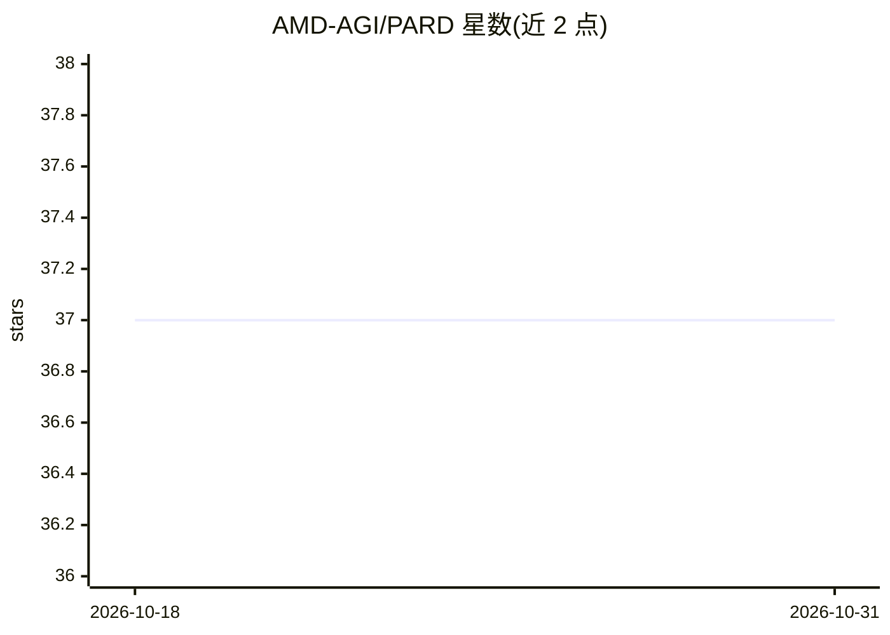

# AMD-AGI/PARD

⭐ 37 · Python · MIT · 推送 2026-06-10 · [GitHub](https://github.com/AMD-AGI/PARD) · 组织维护

**面向 LLM 推理加速的并行草稿模型投机解码方法（ICLR'26）**

PARD 是一族投机解码方法，将自回归草稿模型改造为并行草稿模型，以低成本训练（COD 策略）实现目标模型无关加速；PARD-2 引入目标对齐草稿模型与 CAT 优化，支持双模式（目标无关/目标相关）投机解码。已集成进 vLLM 与 TensorRT-LLM，提供 Docker 基础镜像（ROCm/CUDA）、pip 依赖安装、HuggingFace 权重下载、评测与训练命令。面向做 LLM 推理部署与加速研究的开发者/科研用户。

## 筛选速览

| 维度 | 判定 | 备注 |
|---|---|---|
| AI 角色 | `ai-ecosystem` | LLM/agent 周边工具 |
| 许可风险 | `permissive` | MIT |
| 部署形态 | `library` | 以包/库形式分发 |
| 模型依赖 | local-ok | 支持本地模型 |
| 硬件要求 | — | 无带数字的原话,不猜 |
| 安装摩擦 | `medium` | 含编译或系统依赖之一 |
| 成熟度 | — | 结构信号不足 |

## 能力要点

- COD 策略低成本训练，单个草稿模型可加速一族目标模型
- PARD-2 双模式投机解码与置信度自适应 Token（CAT）优化
- 已集成 vLLM 与 TensorRT-LLM，提供权重与训练/评测代码

## 适用场景

- 在 vLLM/TensorRT-LLM 中加速 LLaMA、Qwen 等模型的推理
- 低成本适配并训练并行草稿模型
- 复现论文在 humaneval/gsm8k 等基准上的加速结果

## 场景标签

`推理引擎` · 领域:训练与推理

## 证据(README 行号)

> L12: **PARD** is a family of high-performance speculative decoding methods designed to accelerate Large Language Model (
> L165: PARD has already been integrated into vLLM. Official example: Document

## 星数曲线

2026-10-18 37 → 2026-10-31 37（+0）

---
*卡片 v1 · prompt 1.4 · 生成 2026-10-25 · 置信度 high · 依据 README sha `7a25dd9fea29` · [字段定义](../../DATASET.md)*
