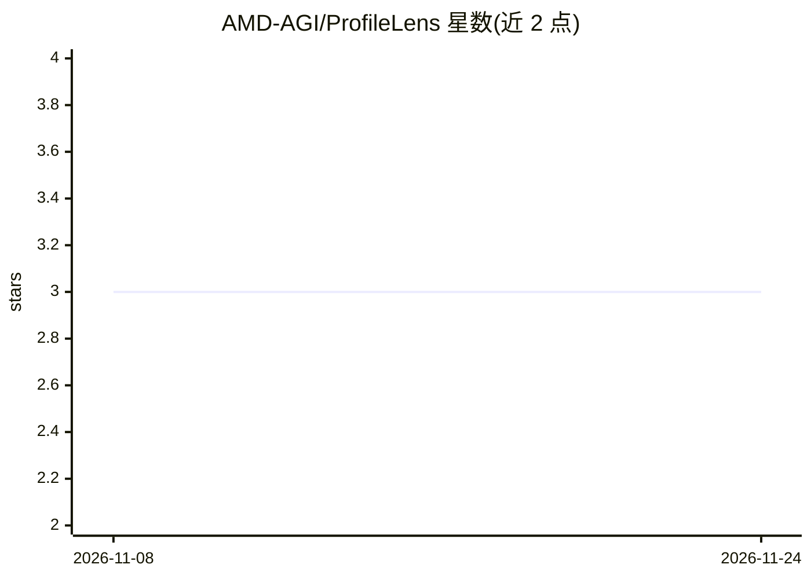

# AMD-AGI/ProfileLens

⭐ 3 · Python · MIT · 推送 2026-11-06 · [GitHub](https://github.com/AMD-AGI/ProfileLens) · 组织维护

**给 AMD GPU 工作负载做内核级性能瓶颈分析的流水线**

结合 Perfetto trace 分析、硬件计数器采样与经验 Roofline 模型的 GPU 性能分析流水线：从 trace 中找出最热内核，从执行钩子解析每个内核的计算 dtype，用 rocprofv3 单趟采样 HW 计数器，按对应 dtype 的经验 Roofline 上限给内核分类瓶颈（COMPUTE/MEMORY/LATENCY/BALANCED）并按可回收端到端时间排序。主入口 full-analysis 一条命令产出报告。要求 Python 3.10+、受 ROCm 支持的 AMD GPU 与 ROCprofiler-SDK 1.4.1+。

## 筛选速览

| 维度 | 判定 | 备注 |
|---|---|---|
| AI 角色 | `ai-ecosystem` | LLM/agent 周边工具 |
| 许可风险 | `permissive` | MIT |
| 部署形态 | `library` | 以包/库形式分发 |
| 模型依赖 | — | README 未给出锁定关系 |
| 硬件要求 | — | 无带数字的原话,不猜 |
| 安装摩擦 | `medium` | 含编译或系统依赖之一 |
| 成熟度 | — | 结构信号不足 |

## 能力要点

- full-analysis 单命令完成 trace 采集、计数器采样与排序报告
- 通过 torch.profiler/Triton/CUDAGraph/MLIR-DSL 执行钩子解析每内核计算 dtype
- 经验 Roofline：实测 HBM 带宽与每 dtype MFMA 上限，按 GPU 型号缓存
- 提供 Python capture API 与 analyze/query 的 SQL trace 检查命令

## 适用场景

- 找出 LLM 推理工作负载中离 Roofline 上限最远的内核
- 对已知内核单独采样计数器以迭代优化
- 用 SQL 自行查询 Perfetto trace 的内核数据

## 场景标签

 · 领域:开发工具/性能分析

## 证据(README 行号)

> L3: GPU performance analysis pipeline that combines Perfetto trace analysis with
> L114: Modern inference mixes precisions. ProfileLens resolves **each kernel's compute dtype** so it can enable the right

## 星数曲线

2026-11-08 3 → 2026-11-24 3（+0）

---
*卡片 v1 · prompt 1.4 · 生成 2026-11-22 · 置信度 high · 依据 README sha `586e709154e0` · [字段定义](../../DATASET.md)*
