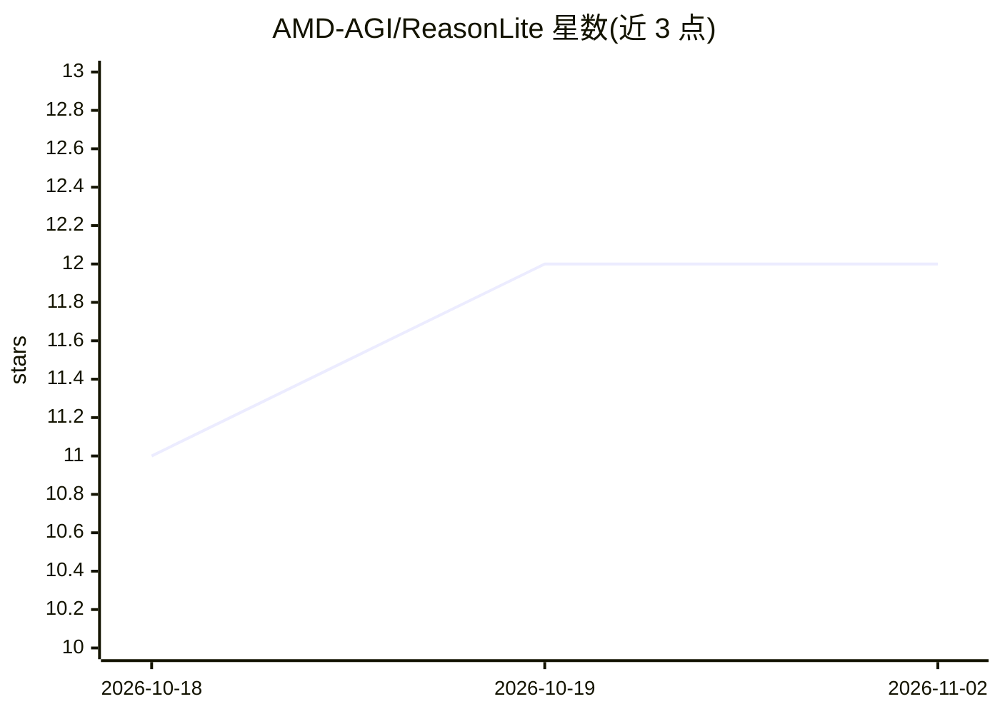

# AMD-AGI/ReasonLite

⭐ 12 · Python · NOASSERTION · 推送 2026-06-10 · [GitHub](https://github.com/AMD-AGI/ReasonLite) · 组织维护

**AMD 开源的 0.6B 参数超轻量数学推理模型及训练数据管线**

ReasonLite 是基于 Qwen3-0.6B 两阶段蒸馏得到的数学推理模型：先用短 CoT 数据得到 Turbo 版（AIME24 11.0→57.1），再用长 CoT 数据提升至 75.2。项目开源模型权重、训练脚本（基于 open-r1）、343K 题目来源的 6.1M 蒸馏数据集及数据合成+过滤管线：以 GPT-OSS 为教师生成 9.1M 答案，多数投票产生伪标签，过滤后保留正确样本。环境推荐 ROCm/CUDA 的 vLLM Docker，训练与评测脚本以 Python 提供。

## 筛选速览

| 维度 | 判定 | 备注 |
|---|---|---|
| AI 角色 | `ai-native` | 本体是模型或模型工具 |
| 许可风险 | `none` | NOASSERTION |
| 部署形态 | `library` | 以包/库形式分发 |
| 模型依赖 | local-ok | 支持本地模型 |
| 硬件要求 | — | 无带数字的原话,不猜 |
| 安装摩擦 | `medium` | 含编译或系统依赖之一 |
| 成熟度 | — | 结构信号不足 |

## 能力要点

- 0.6B 参数模型，README 报告 AIME24 达 75.2
- 两阶段渐进蒸馏（短 CoT → 长 CoT）
- 完整开源数据合成+投票伪标签+过滤管线，产出 6.1M 样本
- 训练基于 open-r1，评测基于 DeepMath

## 适用场景

- 在有限算力下部署数学推理模型
- 复现或扩展小模型蒸馏训练流程
- 使用其合成管线生成带伪标签的推理训练数据

## 场景标签

`微调` · 领域:训练与推理

## 证据(README 行号)

> L10: * **ReasonLite is an ultra-lightweight math reasoning model.** With only 0.6B parameters, it leverages **high-quali
> L18: First, short-CoT data is used to distill **Qwen3-0.6B** into **ReasonLite-0.6B-Turbo**, improving **AIME24 accuracy

## 星数曲线

2026-10-18 11 → 2026-11-02 12（+1）

---
*卡片 v1 · prompt 1.4 · 生成 2026-11-01 · 置信度 high · 依据 README sha `9229e52145f8` · [字段定义](../../DATASET.md)*
