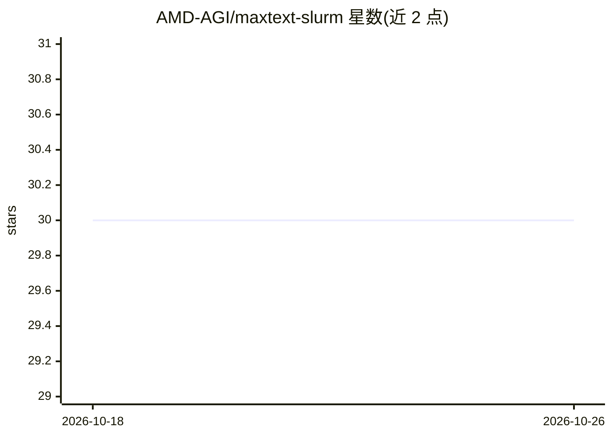

# AMD-AGI/maxtext-slurm

⭐ 30 · Shell · MIT · 推送 2026-07-19 · [GitHub](https://github.com/AMD-AGI/maxtext-slurm) · 组织维护

**在 Slurm 管理的 GPU 集群上启动并观测 MaxText 训练的工具集**

面向 Slurm 调度的 AMD GPU 集群，一条命令即可运行基于 JAX 的 MaxText 分布式 LLM 训练，自动处理模型选择、容器设置与多节点协调。内置可观测性栈（RAY=1 启用），基于 Ray 和 Prometheus 将 GPU、主机、网络与训练指标汇入单一 TSDB，支持 TensorBoard、Ray Dashboard、Prometheus 三个面板与任务结束后回看，另有 Telegram 任务通知。skills/ 目录提供面向 AI agent（Cursor、Claude Code）的结构化技能指令，覆盖性能分析与故障诊断。限制：依赖 Slurm 集群与共享文件系统。

## 筛选速览

| 维度 | 判定 | 备注 |
|---|---|---|
| AI 角色 | `ai-ecosystem` | LLM/agent 周边工具 |
| 许可风险 | `permissive` | MIT |
| 部署形态 | `None` |  |
| 模型依赖 | — | README 未给出锁定关系 |
| 硬件要求 | — | 无带数字的原话,不猜 |
| 安装摩擦 | `low` | 无编译、无系统依赖或容器化 |
| 成熟度 | — | 结构信号不足 |

## 能力要点

- submit.sh 单命令提交多节点 MaxText 训练，模型短名解析到 configs/ 配置
- RAY=1 启用全栈可观测性：GPU/主机/网络/训练指标汇入单一 Prometheus TSDB
- Telegram 任务状态推送与挂起检测，适用于任意 Slurm 任务
- skills/ 目录提供 AI agent 结构化技能（性能分析、故障分诊、TSDB 事件诊断）

## 适用场景

- 在 Slurm 集群上一键启动 llama2/mixtral 等模型的分布式训练
- 长周期训练中监控 GPU 状态、主机健康与网络诊断指标
- 训练任务故障后基于统一 TSDB 做事后诊断

## 场景标签

`模型训练` `LLM 可观测性` · 领域:评测与运维

## 证据(README 行号)

> L3: Toolkit for launching and observing MaxText — a JAX-based LLM training framework — on Slurm-managed AMD GPU clusters
> L70: The `skills/` directory contains structured instructions for AI agents (Cursor, Claude Code). Each skill encodes th

## 星数曲线

2026-10-18 30 → 2026-10-26 30（+0）

---
*卡片 v1 · prompt 1.4 · 生成 2026-10-26 · 置信度 high · 依据 README sha `8464140e6567` · [字段定义](../../DATASET.md)*
