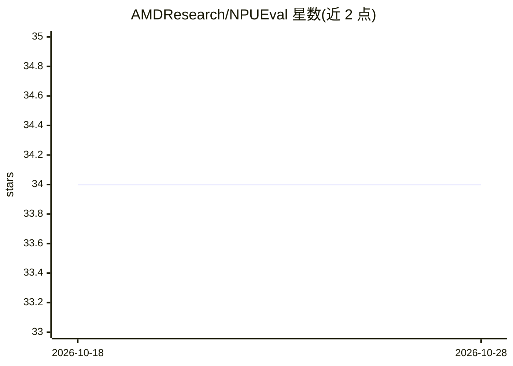

# AMDResearch/NPUEval

⭐ 34 · C++ · 推送 2025-11-08 · [GitHub](https://github.com/AMDResearch/NPUEval) · [官网](https://amdresearch.github.io/NPUEval/) · 组织维护

**面向 RyzenAI 硬件的 AIE 内核代码生成 LLM 评测数据集**

AMDResearch 维护的 LLM 评测数据集，用于测试模型在 AMD RyzenAI NPU 上生成 AIE 内核代码的能力。提供 install.sh 安装脚本（通过 Docker 构建 XRT/XDNA 包并搭建编译环境）、JupyterLab 入门 notebook，以及复现 AIECoder 基线（gpt-4.1、gpt-4o-mini）结果的脚本；评测阶段仅需 NPU 无需 LLM 访问。限制：仅支持 AIE2/AIE2P 内核、单输出内核，需 Ubuntu 24.04+ 且关闭 secure boot。配套 arXiv 论文。

## 筛选速览

| 维度 | 判定 | 备注 |
|---|---|---|
| AI 角色 | `ai-knowledge` | 知识聚合/清单类 |
| 许可风险 | `none` | — |
| 部署形态 | `None` |  |
| 模型依赖 | — | README 未给出锁定关系 |
| 硬件要求 | — | 无带数字的原话,不猜 |
| 安装摩擦 | `low` | 无编译、无系统依赖或容器化 |
| 成熟度 | `idea` | |

## 能力要点

- 针对 AIE 内核代码生成的评测数据集与功能测试评估脚本
- install.sh 搭建 XRT docker 编译环境与 NPUEval docker
- 提供复现 gpt-4.1 / gpt-4o-mini AIECoder 结果的脚本
- 评测阶段仅需 NPU，无需 LLM 访问

## 适用场景

- 评估 LLM 生成 AMD NPU AIE 内核代码的能力
- 复现 AIECoder 基线实验结果
- 在 RyzenAI 硬件上对生成内核运行功能测试

## 场景标签

`模型评测` · 领域:评测与运维

## 证据(README 行号)

> L5: NPUEval is an LLM evaluation dataset written specifically to target AIE kernel code generation on RyzenAI hardware.
> L58: @misc{kalade2025npuevaloptimizingnpukernels,

## 星数曲线

2026-10-18 34 → 2026-10-28 34（+0）

---
*卡片 v1 · prompt 1.4 · 生成 2026-10-25 · 置信度 high · 依据 README sha `d60c0833d125` · [字段定义](../../DATASET.md)*
