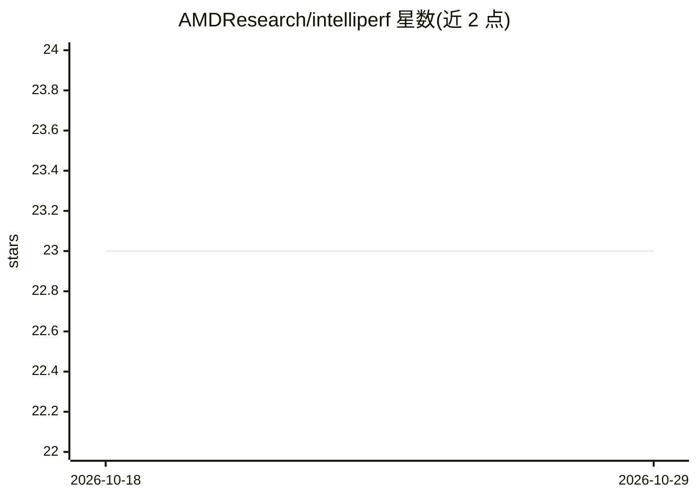

# AMDResearch/intelliperf

⭐ 23 · Python · MIT · 推送 2026-02-24 · [GitHub](https://github.com/AMDResearch/intelliperf) · 组织维护

**AMD 出品的 LLM 驱动 GPU 内核性能自动优化框架**

面向 GPU 内核优化的自动化性能工程框架：用 rocprofiler-compute 采样分析应用，Guided Tuning 识别高层瓶颈，Omniprobe 定位到源码行，再由 LLM 生成优化代码，最后经 Accordo 校验正确性与性能。支持 bank conflict、内存访问模式、原子竞争等瓶颈类型，采用公式驱动架构与多阶段优化循环，可自动生成 PR。目前仅支持 MI300X，仅限研究用途，需通过 LLM_GATEWAY_KEY 接入外部模型，开发模式安装尚不支持标准 pip 发布。

## 筛选速览

| 维度 | 判定 | 备注 |
|---|---|---|
| AI 角色 | `ai-ecosystem` | LLM/agent 周边工具 |
| 许可风险 | `permissive` | MIT |
| 部署形态 | `self-host` | docker 或自建部署 |
| 模型依赖 | — | README 未给出锁定关系 |
| 硬件要求 | — | 无带数字的原话,不猜 |
| 安装摩擦 | `low` | 无编译、无系统依赖或容器化 |
| 成熟度 | `idea` | |

## 能力要点

- rocprofiler-compute 采样 + Omniprobe 定位到具体源码行的瓶颈分析
- LLM 生成优化代码并带迭代反馈
- Accordo 自动校验正确性与性能提升
- 公式驱动架构，支持 bank conflict/内存访问/原子竞争三类瓶颈

## 适用场景

- 自动分析并优化 HIP/Triton 应用的 GPU 内核性能
- 定位 GPU 程序中的 bank conflict 与内存访问瓶颈
- 在 CI 流程中自动生成性能优化 PR

## 场景标签

 · 领域:GPU 性能工程/开发工具

## 证据(README 行号)

> L13: **IntelliPerf** is an automated performance engineering framework that addresses the complex challenge of GPU kerne
> L17: * **AI-Powered Optimization**: Generates optimized code using LLMs with iterative feedback for performance improvem

## 星数曲线

2026-10-18 23 → 2026-10-29 23（+0）

---
*卡片 v1 · prompt 1.4 · 生成 2026-10-27 · 置信度 mid · 依据 README sha `88c9465df50d` · [字段定义](../../DATASET.md)*
