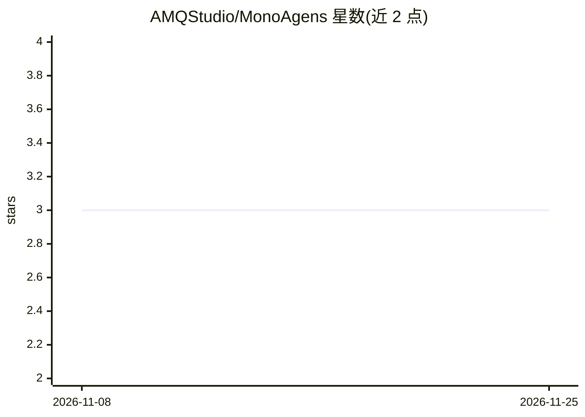

# AMQStudio/MonoAgens

⭐ 3 · Rust · 推送 2026-11-23 · [GitHub](https://github.com/AMQStudio/MonoAgens) · 组织维护

**面向开发者的持久化身份记忆 agent 运行时框架**

以 Rust crates 组织的自主 agent 运行时，核心为 Bodies–Gateway–Valve–Core 四层结构，每个动作输出 done/refused/held/failed/unknown 五种显式结果之一。提供确定性决策循环、SQLite+FTS5+HNSW 向量存储、LLM 与嵌入 Reason 层、Cedar 策略 Valve、NDJSON JSON-RPC 2.0 协议与 Rust/TypeScript/Python SDK、CLI 操作工具及一致性 TCK 测试。隐私机制含作用域过滤、hard_forget 零残留擦除与密钥隔离。从源码经 cargo 构建。

## 筛选速览

| 维度 | 判定 | 备注 |
|---|---|---|
| AI 角色 | `ai-ecosystem` | LLM/agent 周边工具 |
| 许可风险 | `none` | — |
| 部署形态 | `None` |  |
| 模型依赖 | — | README 未给出锁定关系 |
| 硬件要求 | — | 无带数字的原话,不猜 |
| 安装摩擦 | `low` | 无编译、无系统依赖或容器化 |
| 成熟度 | — | 结构信号不足 |

## 能力要点

- 四层核心架构与五类显式动作结果（无隐藏提示与静默失败）
- SQLite hot.db + FTS5 + HNSW 向量存储与同步 hard_forget 擦除
- Cedar + SMT 验证的策略 Valve 与 R_0..R_3 审批机制
- Waist-2 JSON-RPC 协议及 Rust/TypeScript/Python SDK

## 适用场景

- 构建带持久身份与记忆的自主 agent
- 需要策略审批与隐私擦除保障的 agent 部署
- 通过 conformance TCK 验证自定义 body 适配器

## 场景标签

`Agent 框架` · 领域:Agent 开发

## 证据(README 行号)

> L3: An autonomous agent runtime built around a tiny, inspectable four-layer core (`Bodies <-> Gateway <-> Valve <-> Core
> L12: 2. **`waist-valve-and-bodies`** — Canonical **Waist-2 (`monoagens.body.v1`)** protocol & JSON/OpenRPC contracts (`c
> L35: |`sdk/`|Clean-room Waist-2 SDK shims for Rust (`sdk/rust`), TypeScript (`sdk/typescript`), and Python (`sdk/python`

## 星数曲线

2026-11-08 3 → 2026-11-25 3（+0）

---
*卡片 v1 · prompt 1.4 · 生成 2026-11-22 · 置信度 high · 依据 README sha `c298920134d9` · [字段定义](../../DATASET.md)*
