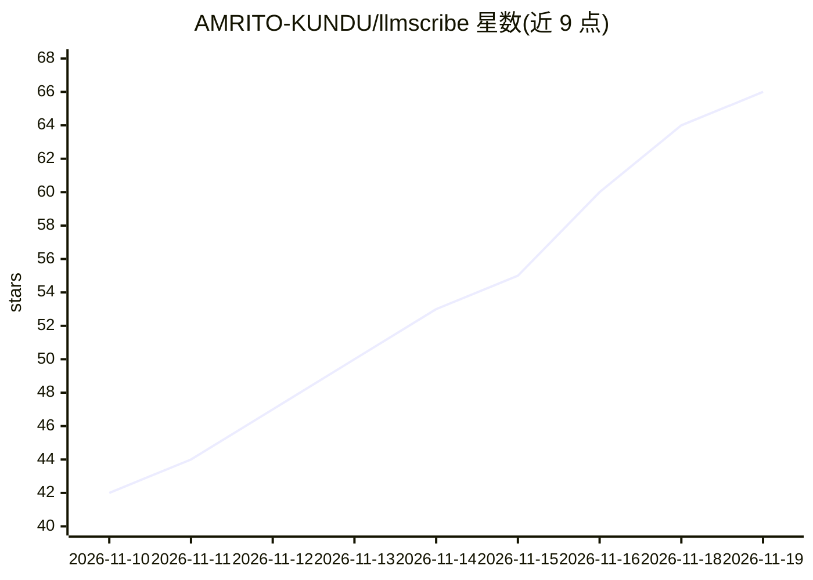

# AMRITO-KUNDU/llmscribe

⭐ 66 · Python · Apache-2.0 · 推送 2026-11-17 · [GitHub](https://github.com/AMRITO-KUNDU/llmscribe) · [官网](https://llmscribe.vercel.app) · 个人维护

**给 AI agent 用的跨平台结构化文件系统接口（MCP/CLI/Python）**

为 AI 编码 agent 提供替代 shell 命令的文件系统访问层：以七个统一操作（map、search、read、read_many、dependencies、diff、overview）在 Linux/macOS/Windows 上输出一致的 JSON 结构，含依赖解析与反向依赖、Git diff、.gitignore 语义、截断显式报告。无 AI、无嵌入、无排序，本地 stdio 运行，无需网络与账号。以标准 MCP 服务器形式接入 Claude Code、Cursor、VS Code、Windsurf、Zed、Cline、Continue、JetBrains、LM Studio 等客户端，也可经 pip 安装用 CLI 或 Python API；另有 Windows 独立 EXE。

## 筛选速览

| 维度 | 判定 | 备注 |
|---|---|---|
| AI 角色 | `ai-ecosystem` | LLM/agent 周边工具 |
| 许可风险 | `permissive` | Apache-2.0 |
| 部署形态 | `self-host` | docker 或自建部署 |
| 模型依赖 | — | README 未给出锁定关系 |
| 硬件要求 | — | 无带数字的原话,不猜 |
| 安装摩擦 | `low` | 无编译、无系统依赖或容器化 |
| 成熟度 | — | 结构信号不足 |

## 能力要点

- 七个跨平台统一 JSON 输出的文件系统操作
- 本地/stdlib/外部依赖解析与反向依赖
- 标准 MCP 服务器，覆盖十余种 MCP 客户端并给出各客户端配置步骤
- 无嵌入无排序，Apache-2.0，纯本地运行无需 API key

## 适用场景

- 让 Claude Code / Cursor 等编码 agent 用结构化方式检索代码库而非解析 shell 输出
- 跨平台团队/CI 中保证 agent 文件操作结果字节一致
- 用渐进式检索（map→search→read）控制大仓库的上下文窗口占用

## 场景标签

 · 领域:AI 编码工具/文件系统接口

## 证据(README 行号)

> L41: LLMScribe gives it one structured interface instead: the same seven operations, the
> L276: LLMScribe is a standard Model Context Protocol server that runs locally over stdio.

## 星数曲线

2026-11-10 42 → 2026-11-19 66（+24）

---
*卡片 v1 · prompt 1.4 · 生成 2026-11-18 · 置信度 mid · 依据 README sha `7f6a647a8c51` · [字段定义](../../DATASET.md)*
