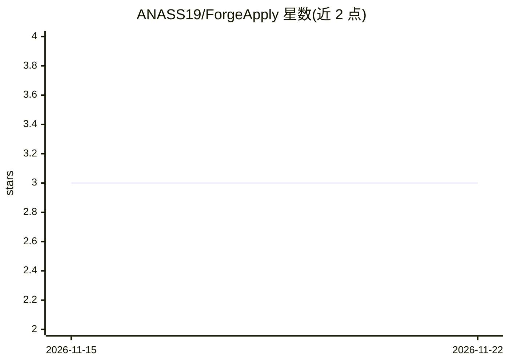

# ANASS19/ForgeApply

⭐ 3 · Python · Apache-2.0 · 推送 2026-11-14 · [GitHub](https://github.com/ANASS19/ForgeApply) · 个人维护

**求职者本地填表的 AI 应用助手：带 RAG 记忆与可控浏览器自动化**

面向求职者的本地优先应用框架：一次性录入职业事实档案，用词法检索（RAG 式）匹配已批准答案，通过有界 observe/plan/act/verify 循环配合 Chrome 扩展填写招聘网站表单，生成定制 CV 与求职信草稿并支持审阅后 PDF 附传。模型可自选本地运行时或托管 API，也支持无模型确定性填写；数据存于用户目录，服务绑定回环，无遥测。当前为开发预览，未覆盖全部 ATS 变体。

## 筛选速览

| 维度 | 判定 | 备注 |
|---|---|---|
| AI 角色 | `ai-native` | 本体是模型或模型工具 |
| 许可风险 | `permissive` | Apache-2.0 |
| 部署形态 | `desktop` | 安装包/桌面程序 |
| 模型依赖 | — | README 未给出锁定关系 |
| 硬件要求 | — | 无带数字的原话,不猜 |
| 安装摩擦 | `low` | 无编译、无系统依赖或容器化 |
| 成熟度 | `idea` | |

## 能力要点

- 基于已批准答案的 RAG 式检索记忆，无需向量数据库
- 有界编排循环：暂停/恢复、本地检查点、可见虚拟光标
- 支持本地运行时、托管 API 与无模型的确定性填写
- 法律/同意与人口统计字段保持人工填写

## 适用场景

- 按岗位定制简历与求职信草稿并审阅后导出
- 让 agent 在授权页面上代为填写申请表单
- 用 SQLite 历史与队列跟踪多个求职机会

## 场景标签

`浏览器自动化` `RAG` `AI 写作` · 领域:效率与自动化

## 证据(README 行号)

> L13: **ForgeApply is an open-source, local-first AI application harness** for turning verified career facts into reviewe
> L27: |Complete supported steps|Bounded observe/plan/act/verify loop, pause/resume, local checkpoints and a visible virtu
> L30: |Use your preferred model|Local runtimes, hosted model APIs, compatible endpoints, or deterministic filling without

## 星数曲线

2026-11-15 3 → 2026-11-22 3（+0）

---
*卡片 v1 · prompt 1.4 · 生成 2026-11-22 · 置信度 mid · 依据 README sha `ef0d2d5430e5` · [字段定义](../../DATASET.md)*
