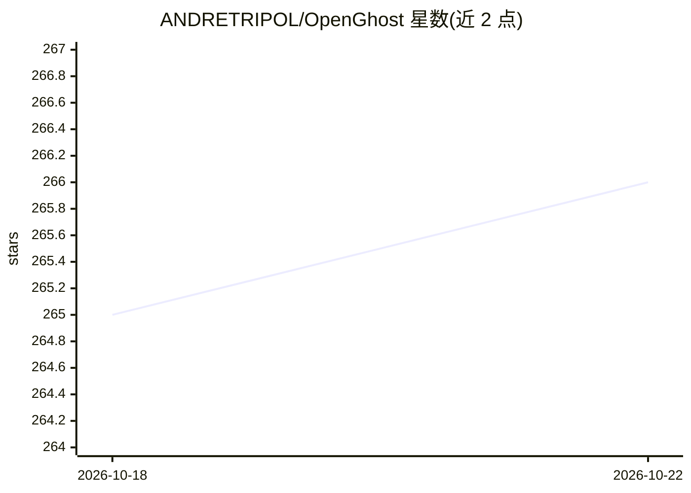

# ANDRETRIPOL/OpenGhost

⭐ 266 · JavaScript · MIT · 推送 2026-10-16 · [GitHub](https://github.com/ANDRETRIPOL/OpenGhost) · [官网](https://andretripol.github.io/OpenGhost/) · 个人维护

**跨平台桌面 AI agent：对话生成回答并配可视化绘图**

面向终端用户的 Electron 桌面 agent 应用，覆盖 Windows/macOS/Linux：可执行命令、编辑文件、操作 git、驱动自研内置浏览器访问网页与用户账户，并在回答旁生成 43 种可交互编辑的图表、示意图与图片视频。自研 agent 循环、绘图引擎、浏览器与 Markdown 渲染器，仅依赖 Electron 与 Anthropic 官方 SDK。支持 ChatGPT 账号登录及 OpenAI/Claude/DeepSeek/OpenRouter API key 接入，密钥本地加密存储；含记忆、笔记、快速聊天、三种权限模式与 Agent Skills 格式技能。v1.4.9 beta 阶段，可从源码构建安装包。

## 筛选速览

| 维度 | 判定 | 备注 |
|---|---|---|
| AI 角色 | `ai-native` | 本体是模型或模型工具 |
| 许可风险 | `permissive` | MIT |
| 部署形态 | `desktop` | 安装包/桌面程序 |
| 模型依赖 | locked-api |  |
| 硬件要求 | — | 无带数字的原话,不猜 |
| 安装摩擦 | `low` | 无编译、无系统依赖或容器化 |
| 成熟度 | `idea` | |

## 能力要点

- 自研 agent 引擎、绘图引擎、浏览器与渲染器，不使用现成 UI/图表/agent 框架
- 43 种可交互、就地编辑的可视化绘图（流程图、曲线图、路线图等）
- 自研内置浏览器：agent 移动自己的光标、点击、输入并读取页面
- 支持 ChatGPT 登录与 OpenAI/Claude/DeepSeek/OpenRouter API key，密钥本地加密存储

## 适用场景

- 用自然语言让 agent 代为执行命令、编辑文件和管理 git 项目
- 在回答旁以图表和示意图理解复杂概念
- 让 agent 在自己已登录的网站账户中完成查询与整理任务

## 场景标签

`AI 助手` `浏览器自动化` · 领域:效率与自动化

## 证据(README 行号)

> L28: OpenGhost is an open desktop agent for Windows, macOS and Linux. It runs commands, edits files, keeps git and works
> L40: - **The agent.** The loop, the tools (commands, files, git, web search, pages, PDFs, video frames), the approval ca

## 星数曲线

2026-10-18 265 → 2026-10-22 266（+1）

---
*卡片 v1 · prompt 1.4 · 生成 2026-10-22 · 置信度 high · 依据 README sha `41e0f7e31ec2` · [字段定义](../../DATASET.md)*
