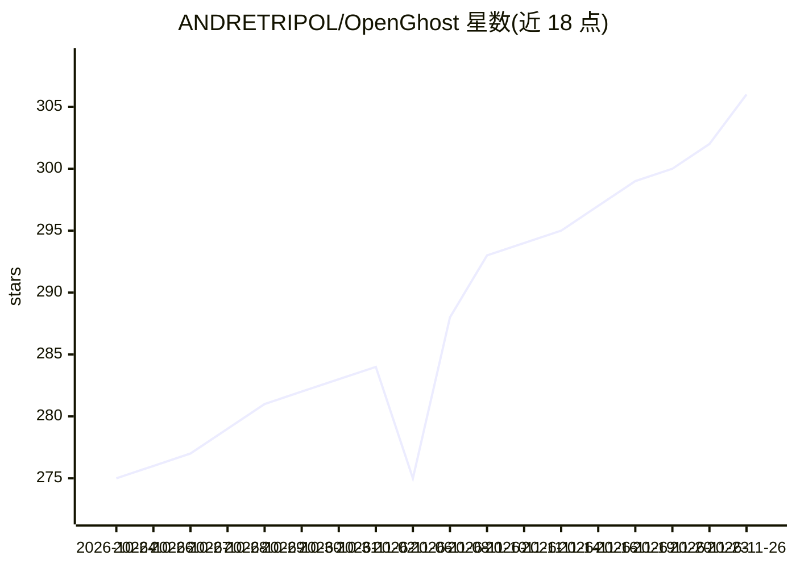

# ANDRETRIPOL/OpenGhost

⭐ 306 · JavaScript · MIT · 推送 2026-11-25 · [GitHub](https://github.com/ANDRETRIPOL/OpenGhost) · [官网](https://andretripol.github.io/OpenGhost/) · 个人维护

**面向个人用户的桌面 AI agent：执行任务并用图表可视化解释**

基于 Electron 的开源桌面 agent，覆盖 Windows/macOS/Linux。自带 agent 引擎、内置浏览器（自主点击输入、可登录用户账号）、绘图引擎（43 种图形随回答生成且可就地编辑），支持命令执行、文件编辑、git、多步计划与完成校验、定时例程、记忆分层、技能格式与快速聊天窗口。接口仅依赖 Electron 与 Anthropic 官方 SDK；设置中可配规则约束 agent 行为。提供各平台版本下载与网页试用。

## 筛选速览

| 维度 | 判定 | 备注 |
|---|---|---|
| AI 角色 | `ai-native` | 本体是模型或模型工具 |
| 许可风险 | `permissive` | MIT |
| 部署形态 | `desktop` | 安装包/桌面程序 |
| 模型依赖 | local-ok | 支持本地模型 |
| 硬件要求 | — | 无带数字的原话,不猜 |
| 安装摩擦 | `low` | 无编译、无系统依赖或容器化 |
| 成熟度 | — | 结构信号不足 |

## 能力要点

- 自研 agent 引擎：命令/文件/git/网页工具、审批卡片与三种权限模式
- 绘图引擎读取模型输出并绘制 43 种图形，支持就地编辑
- 内置浏览器：agent 以编号元素视图操作页面，可工作在用户已登录账号内
- 多步计划带完成校验（测试/构建/回读检查），例程可在后台运行

## 适用场景

- 让 agent 操作浏览器完成账号内的日常事务（如整理评论、统计浏览量）
- 以图表和示意图方式学习与讲解概念、流程和数据
- 让 agent 自动执行代码修改并跑测试、构建等校验后收尾
- 设定每日/定时任务（如价格监控、晨间检查）由例程在后台完成

## 场景标签

`AI 助手` `浏览器自动化` · 领域:效率与自动化

## 证据(README 行号)

> L27: OpenGhost is an open desktop agent for Windows, macOS and Linux. It runs commands, edits files, keeps git and works
> L43: The app stands on two things only: Electron, which gives it a window, and Anthropic's official SDK, which talks to 
> L37: - **The agent.** The loop, the tools (commands, files, git, web search, pages, PDFs, video frames), the approval ca

## 星数曲线

2026-10-24 275 → 2026-11-26 306（+31）

---
*卡片 v1 · prompt 1.4 · 生成 2026-11-25 · 置信度 high · 依据 README sha `9827af927239` · [字段定义](../../DATASET.md)*
