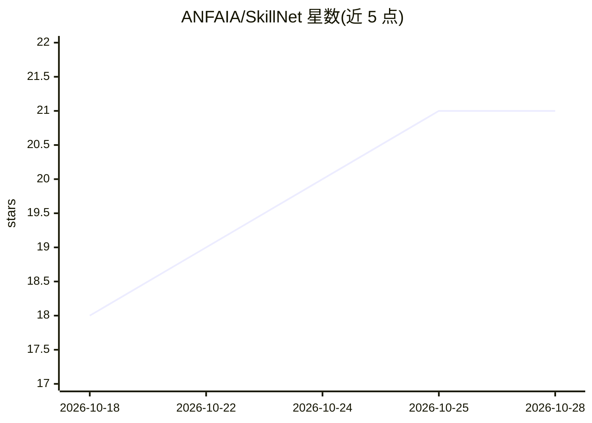

# ANFAIA/SkillNet

⭐ 21 · Python · Apache-2.0 · 推送 2026-10-15 · [GitHub](https://github.com/ANFAIA/SkillNet) · 组织维护

**把想法或文档变成自适应课程与导师的学习系统**

面向个人、班级、团队与组织的学习平台：从一段学习主题或上传的 PDF/DOCX/Markdown/TXT 材料生成结构化课程，包含课程、练习、导师与学习媒体（播客、信息图、幻灯片、解说视频）。导师回答基于已注册来源并返回出处。系统区分稳定的『学习契约』（知识、目标、评价标准）与可自适应的体验（讲解、练习、媒介与界面），并以 Docker 加 OpenAI 兼容模型提供方在自有基础设施上运行。

## 筛选速览

| 维度 | 判定 | 备注 |
|---|---|---|
| AI 角色 | `ai-native` | 本体是模型或模型工具 |
| 许可风险 | `permissive` | Apache-2.0 |
| 部署形态 | `self-host` | docker 或自建部署 |
| 模型依赖 | — | README 未给出锁定关系 |
| 硬件要求 | — | 无带数字的原话,不猜 |
| 安装摩擦 | `low` | 无编译、无系统依赖或容器化 |
| 成熟度 | — | 结构信号不足 |

## 能力要点

- 从主题或 PDF/DOCX/Markdown/TXT 生成完整课程
- 导师回答基于已注册来源并返回出处
- 生成播客、信息图、幻灯片、解说视频等学习媒体
- 通过 REST API 与可选 A2A、MCP 适配器连接其他工具

## 适用场景

- 把内部文档整理成结构化课程给团队学习
- 按学习者的偏好与进度调整讲解与练习
- 在自有基础设施上部署组织级学习平台

## 场景标签

`多智能体` `文档问答` · 领域:Agent 开发

## 证据(README 行号)

> L25: Markdown and TXT material. It then builds a structured course with lessons, exercises, a tutor and
> L51: - **Generates learning media** such as podcasts, infographics, slide decks and narrated videos when

## 星数曲线

2026-10-18 18 → 2026-10-28 21（+3）

---
*卡片 v1 · prompt 1.4 · 生成 2026-10-28 · 置信度 high · 依据 README sha `2ff358bda82d` · [字段定义](../../DATASET.md)*
