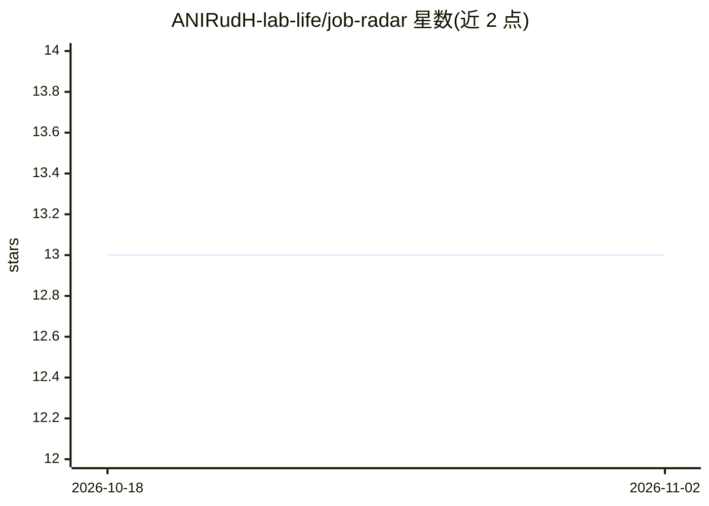

# ANIRudH-lab-life/job-radar

⭐ 13 · Python · MIT · 推送 2026-10-22 · [GitHub](https://github.com/ANIRudH-lab-life/job-radar) · [官网](https://anirudh-lab-life.github.io/job-radar/) · 个人维护

**本地 LLM 打分的求职搜索 CLI，聚合 8 个免费职位源**

面向求职者的命令行工具：一次搜索 Remotive、RemoteOK、Greenhouse、Ashby 等 8 个免费职位源（含 2 个直连 ATS 与可选 LinkedIn 抓取），用本地 LLM（自动探测 Ollama 或 llama.cpp，默认 qwen3:1.7b）按技能、经验、薪资、远程匹配度给职位打 0-100 分并生成说明。全部 AI 本地运行、无需云端 API；带持久化已见缓存、终端彩色输出，以及 localhost:3000 的看板式 Web 仪表盘。支持 --no-ai 跳过评分。

## 筛选速览

| 维度 | 判定 | 备注 |
|---|---|---|
| AI 角色 | `ai-enhanced` | 去掉 AI 部分产品仍成立 |
| 许可风险 | `permissive` | MIT |
| 部署形态 | `library` | 以包/库形式分发 |
| 模型依赖 | local-ok | 支持本地模型 |
| 硬件要求 | — | 无带数字的原话,不猜 |
| 安装摩擦 | `low` | 无编译、无系统依赖或容器化 |
| 成熟度 | — | 结构信号不足 |

## 能力要点

- 聚合 8 个免费职位源，含 Greenhouse/Ashby 直连 ATS
- 本地 LLM 按技能/经验/薪资/远程四维打分 0-100，离线运行
- Web 仪表盘：看板管道、职位卡片、配置编辑器
- 7 天已见职位缓存，避免重复筛选

## 适用场景

- 一次搜索多个远程职位源并拿到打分排序的清单
- 用看板跟踪职位从发现到面试的流程
- 本地跑 LLM 给职位匹配度打分，不上传个人资料到云端

## 场景标签

 · 领域:求职/职业工具

## 证据(README 行号)

> L3: A CLI job search agent that hunts across 8 free sources at once and helps you figure out which ones are actually wor
> L18: - **Rates jobs with a local LLM** — auto-detects Ollama or llama.cpp, scores each job 0-100 on skills match, experi
> L179: |`--no-ai`|off|Skip AI rating (faster)|

## 星数曲线

2026-10-18 13 → 2026-11-02 13（+0）

---
*卡片 v1 · prompt 1.4 · 生成 2026-10-31 · 置信度 high · 依据 README sha `3d0036e07485` · [字段定义](../../DATASET.md)*
