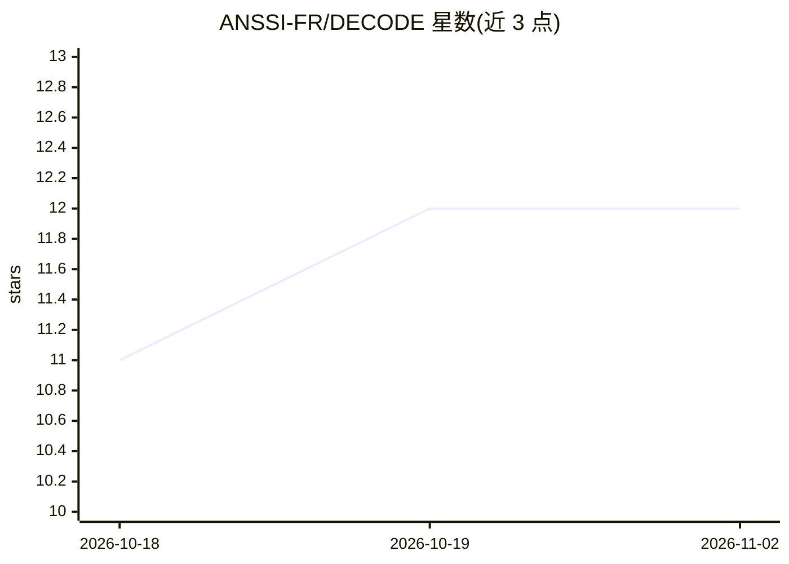

# ANSSI-FR/DECODE

⭐ 12 · Python · BSD-3-Clause · 推送 2026-03-07 · [GitHub](https://github.com/ANSSI-FR/DECODE) · 组织维护

**基于 DFIR-ORC 数据检测 Windows PE 文件异常的取证工具**

法国国家网络安全局（ANSSI）开发的独立工具：读取 DFIR-ORC 采集的 NTFSInfo 与 ListDlls 数据（CSV/TXT 或 7z 归档），结合传统离群点检测算法与图异常检测，仅利用文件元数据对机器上的 PE 文件按异常程度从高到低排序，不依赖预训练模型。输出 CSV 结果与基于树结构的 PDF 可视化，并提供可集成到 Splunk 平台的 dashboard 应用。面向事件响应与失陷评估中的取证分析人员。需系统安装 graphviz。

## 筛选速览

| 维度 | 判定 | 备注 |
|---|---|---|
| AI 角色 | `ai-native` | 本体是模型或模型工具 |
| 许可风险 | `permissive` | BSD-3-Clause |
| 部署形态 | `desktop` | 安装包/桌面程序 |
| 模型依赖 | — | README 未给出锁定关系 |
| 硬件要求 | — | 无带数字的原话,不猜 |
| 安装摩擦 | `low` | 无编译、无系统依赖或容器化 |
| 成熟度 | — | 结构信号不足 |

## 能力要点

- 传统离群点检测 + 图异常检测对 PE 文件排序
- 仅利用文件元数据，不依赖预训练模型，不分析二进制内容
- 输出 CSV 与树状 PDF 可视化，附 Splunk dashboard 应用
- 支持直接读取 NTFSInfo CSV 或 DFIR-ORC 7z 归档

## 适用场景

- 应急响应或失陷评估时优先排查最可疑的 PE 文件
- 分析 DFIR-ORC 采集的主机 NTFSInfo 与 ListDlls 数据
- 在 Splunk 平台中集成查看异常检测结果

## 场景标签

`网络安全` · 领域:学习与行业

## 证据(README 行号)

> L8: DECODE, or "DEtection de COmpromissions dans les DonnéEs DFIR-ORC" in French, is a stand-alone tool specifically des
> L10: This tool ranks PE files found on a machine from most to least anomalous, allowing forensic analysts to prioritize 
> L12: Anomaly scores are computed using both traditional outlier detection algorithms and graph-based anomaly detection. 

## 星数曲线

2026-10-18 11 → 2026-11-02 12（+1）

---
*卡片 v1 · prompt 1.4 · 生成 2026-11-01 · 置信度 high · 依据 README sha `550217b360c2` · [字段定义](../../DATASET.md)*
