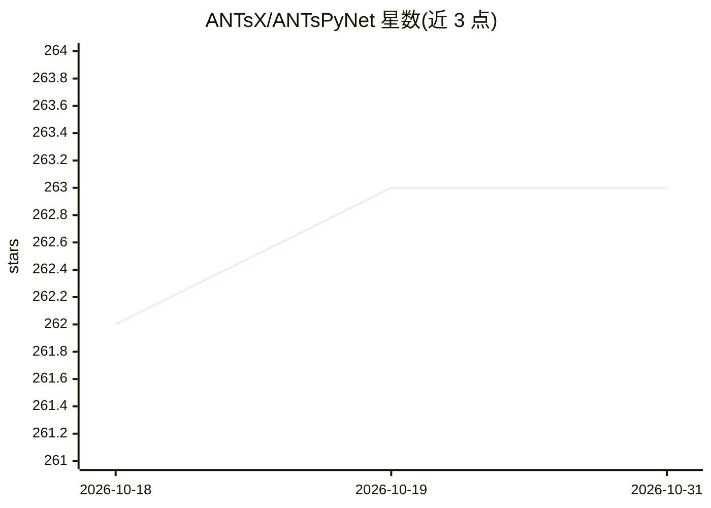

# ANTsX/ANTsPyNet

⭐ 263 · Python · Apache-2.0 · 推送 2026-10-24 · [GitHub](https://github.com/ANTsX/ANTsPyNet) · [官网](https://antspynet.readthedocs.io) · 组织维护

**医学影像深度学习库：预训练模型+网络架构+训练工具**

基于 Keras/TensorFlow 的医学影像深度学习 Python 库，与 R 版 ANTsRNet 交叉兼容。提供三类功能：常用深度学习架构（U-Net、ResNet、GAN 等，多为 2-D/3-D 版本）的初始化；针对脑提取、组织分割、皮层厚度、海马分割、肺部分割、MRI 超分等任务的预训练模型；以及面向医学图像的训练评估辅助函数与数据增强工具。覆盖人脑、肺、小鼠脑等多类应用，pip 安装，Apache 许可。

## 筛选速览

| 维度 | 判定 | 备注 |
|---|---|---|
| AI 角色 | `ai-native` | 本体是模型或模型工具 |
| 许可风险 | `permissive` | Apache-2.0 |
| 部署形态 | `self-host` | docker 或自建部署 |
| 模型依赖 | — | README 未给出锁定关系 |
| 硬件要求 | — | 无带数字的原话,不猜 |
| 安装摩擦 | `low` | 无编译、无系统依赖或容器化 |
| 成熟度 | — | 结构信号不足 |

## 能力要点

- 预训练模型直接执行脑提取、组织分割、海马/肺部分割等任务
- 2-D/3-D 深度学习架构集合（U-Net、ResNet、DenseNet、GAN 等）
- 医学影像数据增强与训练评估工具函数
- 与 R 版 ANTsRNet 交叉兼容

## 适用场景

- 用预训练模型对脑部 MRI 做提取与分割
- 初始化常用架构训练自己的医学影像模型
- 对肺部影像做分割与功能肺量化

## 场景标签

`目标检测` `图像视频处理` · 领域:感知与多模态

## 证据(README 行号)

> L8: A collection of deep learning architectures and applications ported to the Python language and tools for basic medic
> L11: - Various pre-trained deep learning models to perform key medical imaging tasks

## 星数曲线

2026-10-18 262 → 2026-10-31 263（+1）

---
*卡片 v1 · prompt 1.4 · 生成 2026-10-22 · 置信度 mid · 依据 README sha `2fa8068f97e5` · [字段定义](../../DATASET.md)*
