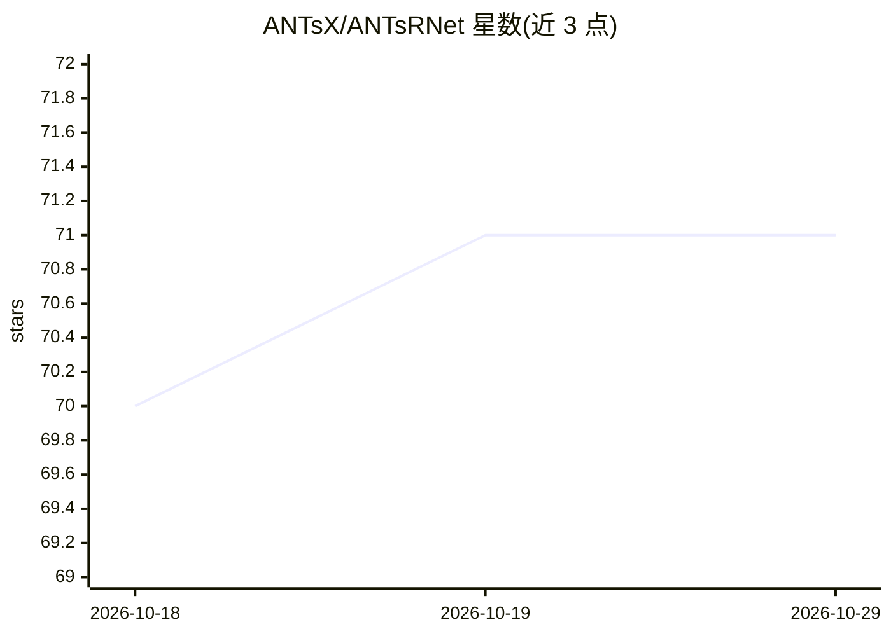

# ANTsX/ANTsRNet

⭐ 71 · R · Apache-2.0 · 推送 2026-05-23 · [GitHub](https://github.com/ANTsX/ANTsRNet) · 组织维护

**给 R 用户的医学影像深度学习架构与预训练模型库**

基于 keras 与 tensorflow 的 R 语言医学影像深度学习工具集：提供 U-Net、ResNet、DenseNet、GAN、超分辨率等多种 2-D/3-D 架构初始化，内置脑提取、组织分割、海马分割、肺分割、脑龄估计等预训练模型应用，覆盖人脑、肺、小鼠脑等影像任务，另含数据增强与图像质量评估工具。与 Python 版 ANTsPyNet 跨兼容。安装需先装 R 与 keras，再从源码编译（依赖 ITKR/ANTsRCore/ANTsR，需 CMake）。

## 筛选速览

| 维度 | 判定 | 备注 |
|---|---|---|
| AI 角色 | `ai-native` | 本体是模型或模型工具 |
| 许可风险 | `permissive` | Apache-2.0 |
| 部署形态 | `None` |  |
| 模型依赖 | — | README 未给出锁定关系 |
| 硬件要求 | — | 无带数字的原话,不猜 |
| 安装摩擦 | `medium` | 含编译或系统依赖之一 |
| 成熟度 | — | 结构信号不足 |

## 能力要点

- 医学影像常用深度学习架构的 R 实现（2-D/3-D）
- 大量预训练模型：脑提取、分割、超分辨率、脑龄等
- 与 Python 版 ANTsPyNet 跨兼容
- 模板化数据增强与图像质量评估工具

## 适用场景

- 用 R 完成脑部 MRI 的提取与组织分割
- 肺部影像分割与超分辨率处理
- 在 R 中初始化 U-Net 等架构做医学影像训练

## 场景标签

`图像视频处理` · 领域:感知与多模态

## 证据(README 行号)

> L6: A collection of deep learning architectures and applications ported to the R language and tools for basic medical im
> L9: - Various pre-trained deep learning models to perform key medical imaging tasks
> L85:  Applications

## 星数曲线

2026-10-18 70 → 2026-10-29 71（+1）

---
*卡片 v1 · prompt 1.4 · 生成 2026-10-24 · 置信度 high · 依据 README sha `0b076a879f96` · [字段定义](../../DATASET.md)*
