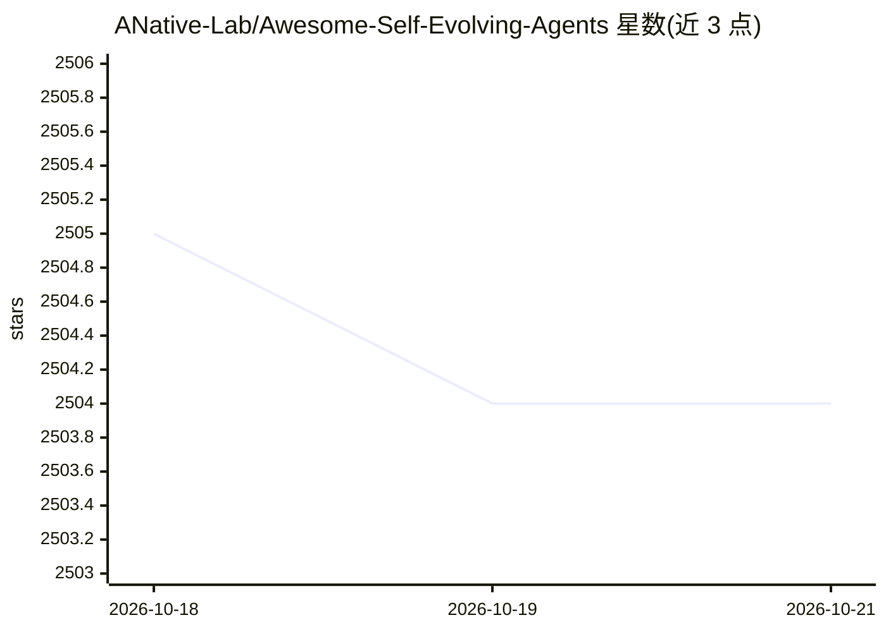

# ANative-Lab/Awesome-Self-Evolving-Agents

⭐ 2,504 · MIT · 推送 2026-05-16 · [GitHub](https://github.com/ANative-Lab/Awesome-Self-Evolving-Agents) · [官网](https://arxiv.org/pdf/2508.07407) · 组织维护

**自进化 AI Agent 研究论文策展清单（配综述与分类框架）**

围绕“自进化 AI Agent”主题的论文与开源框架聚合清单，配套 arXiv 综述。按单智能体优化、多智能体优化、领域专用优化三大方向组织，细分为 LLM 行为优化（训练/测试时）、提示优化（编辑/进化/生成/文本梯度）、记忆优化、工具优化等类别；条目标注会议来源、论文链接，部分附代码链接，收录 2022-2025 年工作，欢迎社区贡献。

## 筛选速览

| 维度 | 判定 | 备注 |
|---|---|---|
| AI 角色 | `ai-knowledge` | 知识聚合/清单类 |
| 许可风险 | `permissive` | MIT |
| 部署形态 | `None` |  |
| 模型依赖 | — | README 未给出锁定关系 |
| 硬件要求 | — | 无带数字的原话,不猜 |
| 安装摩擦 | `low` | 无编译、无系统依赖或容器化 |
| 成熟度 | `idea` | |

## 能力要点

- 按 Evolve Tree 分类法组织 2022-2025 年自进化 agent 论文
- 覆盖行为优化、提示优化、记忆优化、工具优化四大主题
- 配套 arXiv 综述论文与可视化分类框架图
- 收录 EvoAgentX、MASLab 等开源框架条目

## 适用场景

- 查找自进化 agent 方向的研究论文与代码
- 按分类体系了解该领域方法演进脉络
- 为 agent 优化研究选题做文献调研

## 场景标签

`科研工具` `精选清单` · 领域:学习与行业

## 证据(README 行号)

> L13:  Figure: A visual taxonomy of AI agent evolution and optimisation techniques, categorised into three major directio
> L28: ## 1. Single-Agent Optimisation

## 星数曲线

2026-10-18 2,505 → 2026-10-21 2,504（-1）

---
*卡片 v1 · prompt 1.4 · 生成 2026-10-21 · 置信度 high · 依据 README sha `a2d4e9ce9cdc` · [字段定义](../../DATASET.md)*
