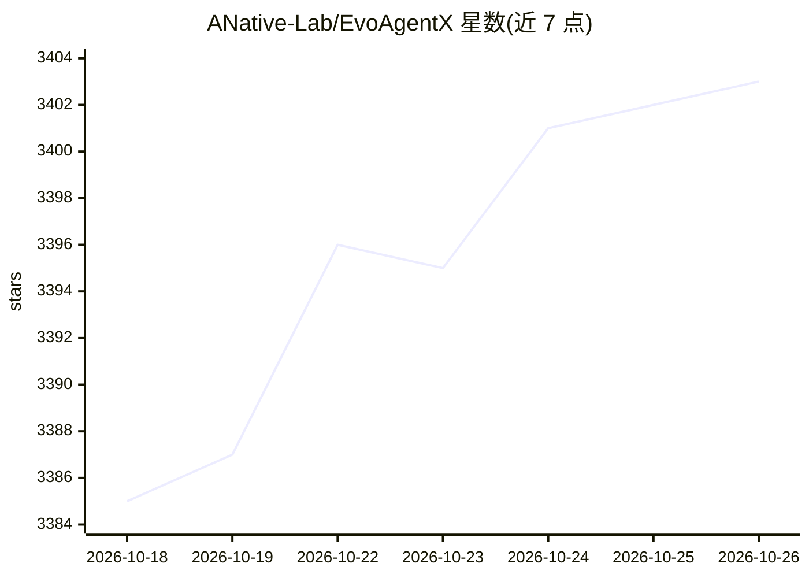

# ANative-Lab/EvoAgentX

⭐ 3,403 · Python · NOASSERTION · 推送 2026-10-22 · [GitHub](https://github.com/ANative-Lab/EvoAgentX) · [官网](https://anative-lab.github.io/EvoAgentX/) · 组织维护 · 中文 README

**自进化多智能体工作流框架：从目标自动构建并优化 agent 工作流**

开源 LLM agent 框架，面向 AI 研究者、workflow 工程师与创业团队。核心机制：从单一自然语言目标自动生成结构化多智能体工作流，内置任务评分评估器，通过自进化算法迭代优化工作流；支持短/长期记忆、人在环路（HITLManager 审批与输入注入）、20+ 内置工具（代码解释器、搜索、数据库、浏览器等）与 MCP 工具接入。模型经 LiteLLM/siliconflow/openrouter 接入 OpenAI、Claude、DeepSeek、Qwen 等，本地部署可用 LiteLLM。以 pip 包提供，附 arXiv 框架论文。

## 筛选速览

| 维度 | 判定 | 备注 |
|---|---|---|
| AI 角色 | `ai-ecosystem` | LLM/agent 周边工具 |
| 许可风险 | `none` | NOASSERTION |
| 部署形态 | `library` | 以包/库形式分发 |
| 模型依赖 | — | README 未给出锁定关系 |
| 硬件要求 | — | 无带数字的原话,不猜 |
| 安装摩擦 | `low` | 无编译、无系统依赖或容器化 |
| 成熟度 | — | 结构信号不足 |

## 能力要点

- 从自然语言目标自动生成多智能体工作流（WorkFlowGenerator/AgentManager）
- 内置自动评估器与自进化算法迭代优化工作流
- 短/长期记忆模块与 Human-in-the-Loop 审批/输入机制
- 20+ 内置工具（代码、搜索、数据库、图像、浏览器）及 MCP 工具支持

## 适用场景

- 从模糊想法快速搭建可运行的多智能体系统
- 基于自有数据集自动优化 agentic workflow
- 需要人工审核关键决策的交互式 agent 工作流

## 场景标签

`Agent 框架` `多智能体` `工作流自动化` `Agent 记忆` · 领域:Agent 开发

## 证据(README 行号)

> L19: EvoAgentX is an open-source framework for building, evaluating, and evolving LLM-based agents or agentic workflows 
> L33:  Agents don’t just work—they learn. EvoAgentX improves workflows using self-evolving algorithms.

## 星数曲线

2026-10-18 3,385 → 2026-10-26 3,403（+18）

---
*卡片 v1 · prompt 1.4 · 生成 2026-10-21 · 置信度 high · 依据 README sha `29bfa78970fa` · [字段定义](../../DATASET.md)*
