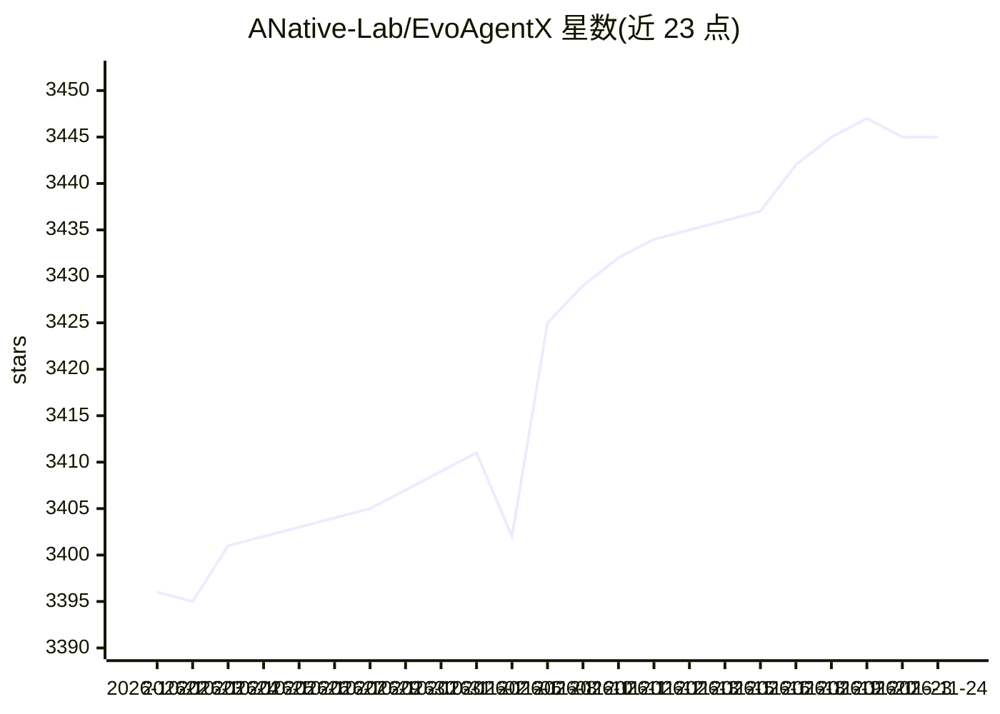

# ANative-Lab/EvoAgentX

⭐ 3,447 · Python · NOASSERTION · 推送 2026-10-31 · [GitHub](https://github.com/ANative-Lab/EvoAgentX) · [官网](https://anative-lab.github.io/EvoAgentX/) · 组织维护 · 中文 README

**面向开发者与研究者的自演化多智能体工作流框架**

EvoAgentX 是一个开源 Python 框架，用于构建、评估并迭代优化基于 LLM 的智能体与多智能体工作流：从自然语言目标自动生成结构化工作流，内置任务导向的评估器与自演化算法，通过反馈循环改进工作流。提供短期/长期记忆模块、人机协同（HITL）审批与输入收集机制，以及覆盖代码执行、搜索、文件系统、数据库、图像与浏览器自动化的内置工具集，并支持 MCP 工具。通过 pip 或源码安装，LLM 经 API key 或 LiteLLM 接入。

## 筛选速览

| 维度 | 判定 | 备注 |
|---|---|---|
| AI 角色 | `ai-ecosystem` | LLM/agent 周边工具 |
| 许可风险 | `none` | NOASSERTION |
| 部署形态 | `library` | 以包/库形式分发 |
| 模型依赖 | — | README 未给出锁定关系 |
| 硬件要求 | — | 无带数字的原话,不猜 |
| 安装摩擦 | `low` | 无编译、无系统依赖或容器化 |
| 成熟度 | — | 结构信号不足 |

## 能力要点

- 从单个 prompt 自动构建多智能体工作流（WorkFlowGenerator）
- 内置评估器与自演化算法，通过迭代反馈优化工作流
- 短期与长期记忆模块，支持跨交互的记忆与反思
- 内置 20 余种工具（代码沙箱、搜索、数据库、浏览器）并支持 MCP

## 适用场景

- 基于自有数据集自动演化优化智能体工作流
- 需要人工审批环节的多智能体业务流程
- 为研究者提供自演化 agent 算法实验框架
- 让智能体调用搜索/代码/浏览器等工具执行实际任务

## 场景标签

`多智能体` `Agent 记忆` `Agent 框架` · 领域:Agent 开发

## 证据(README 行号)

> L19: EvoAgentX is an open-source framework for building, evaluating, and evolving LLM-based agents or agentic workflows 
> L178: 2. Generate the workflow with `WorkFlowGenerator`
> L36:  Easily integrate original OpenAI and qwen or other popular models, including Claude, Deepseek, kimi models through

## 星数曲线

2026-10-22 3,396 → 2026-11-24 3,445（+49）

---
*卡片 v1 · prompt 1.4 · 生成 2026-11-23 · 置信度 high · 依据 README sha `48eff9007d6c` · [字段定义](../../DATASET.md)*
