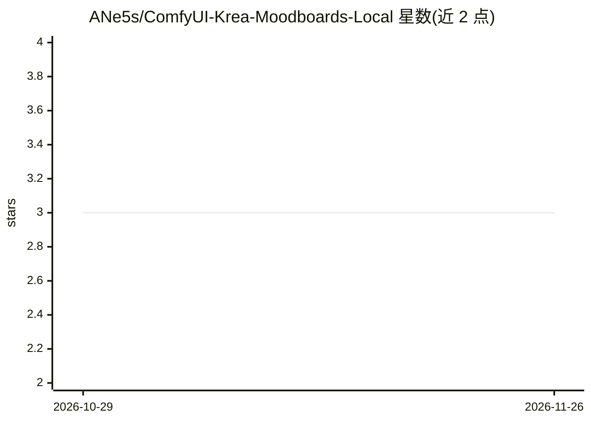

# ANe5s/ComfyUI-Krea-Moodboards-Local

⭐ 3 · Python · MIT · 推送 2026-10-16 · [GitHub](https://github.com/ANe5s/ComfyUI-Krea-Moodboards-Local) · [官网](https://github.com/ANe5s/ComfyUI-Krea2-Harness) · 个人维护 · 中文 README

**ComfyUI 本地化 Krea moodboard 风格浏览器插件**

ComfyUI 自定义节点，内嵌 3,549 个 Krea moodboard 与 60 个 Andro.Meta 精选风格目录（含简体中文标题与摘要），支持搜索、按风格族过滤、随机选取与收藏，浏览全程离线、不访问 Krea CDN。节点仅输出 positive/negative/title/uuid/metadata_json 五个 STRING，不加载模型、不生成图像；与 Krea2 Harness 示例工作流配合，通过 Moodboard Adapter 将风格引导传入文生图流程。需已有 ComfyUI 自定义节点安装环境，无额外 Python 依赖。

## 筛选速览

| 维度 | 判定 | 备注 |
|---|---|---|
| AI 角色 | `ai-enhanced` | 去掉 AI 部分产品仍成立 |
| 许可风险 | `permissive` | MIT |
| 部署形态 | `None` |  |
| 模型依赖 | — | README 未给出锁定关系 |
| 硬件要求 | — | 无带数字的原话,不猜 |
| 安装摩擦 | `low` | 无编译、无系统依赖或容器化 |
| 成熟度 | — | 结构信号不足 |

## 能力要点

- 内置 3,609 条目录与 256px WebP 缩略图，离线浏览不联系 Krea 服务
- 支持 ComfyUI i18n，提供英文与简体中文界面及中文卡片摘要
- 节点仅返回 STRING 输出，不加载模型、不生成图像
- 兼容原项目的并行安装，无需安装上游项目即可使用

## 适用场景

- 在 ComfyUI 工作流中为文生图挑选并传入风格引导
- 离线浏览 moodboard 风格目录与缩略图
- 为 Krea2 Harness 工作流提供 moodboard 环节

## 场景标签

`图像生成` · 领域:内容生成

## 证据(README 行号)

> L3: Krea Moodboards for ComfyUI: browse local style references and send prompt guidance into a workflow.
> L58: The node returns `STRING` values only. It does not load a model, generate images, or output conditioning.
> L11: Built for the moodboard step in ComfyUI-Krea2-Harness workflows, with ComfyUI i18n support in English and Simplifie

## 星数曲线

2026-10-29 3 → 2026-11-26 3（+0）

---
*卡片 v1 · prompt 1.4 · 生成 2026-11-26 · 置信度 mid · 依据 README sha `17818b8b28ae` · [字段定义](../../DATASET.md)*
