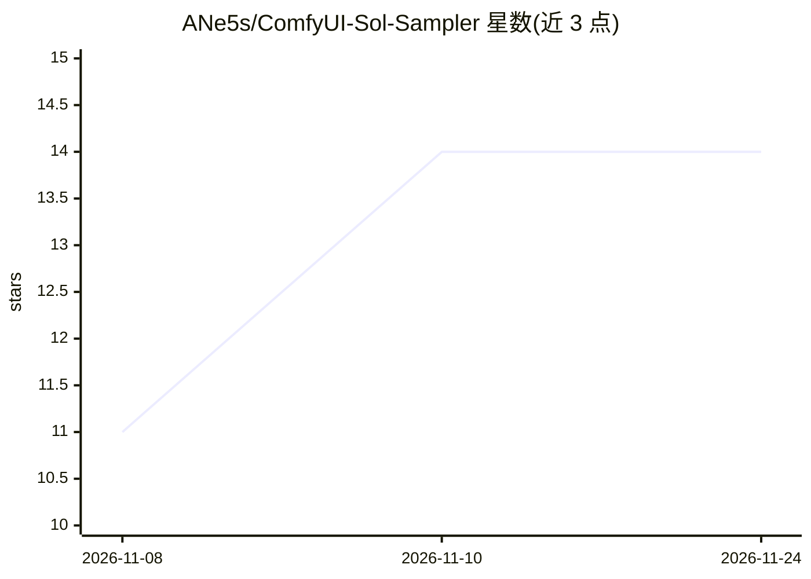

# ANe5s/ComfyUI-Sol-Sampler

⭐ 14 · Python · Apache-2.0 · 推送 2026-11-07 · [GitHub](https://github.com/ANe5s/ComfyUI-Sol-Sampler) · 个人维护 · 中文 README

**ComfyUI 采样节点：MiniMax H3 高分辨率长视频一次采样生成**

一个 ComfyUI 自定义节点，实现一次执行内的渐进式采样：先在低分辨率去噪、latent 上采样后在同一采样运行中继续高分辨率去噪，面向 MiniMax H3 的高分辨率长视频生成。核心机制是基于 ComfyUI 原生 Model Sparse Attention（Sol-Attn）的错峰注意力预热，以及跨分辨率噪声耦合（2D 正交 Haar LL 降采样为默认，双线性插值为可选模式）。安装方式是将文件夹放入 ComfyUI/custom_nodes 后重启；学习型上采样需另行放置 MiniMax H3 latent 上采样器检查点。

## 筛选速览

| 维度 | 判定 | 备注 |
|---|---|---|
| AI 角色 | `ai-native` | 本体是模型或模型工具 |
| 许可风险 | `permissive` | Apache-2.0 |
| 部署形态 | `None` |  |
| 模型依赖 | — | README 未给出锁定关系 |
| 硬件要求 | `gpu-8g` | |
| 安装摩擦 | `low` | 无编译、无系统依赖或容器化 |
| 成熟度 | — | 结构信号不足 |

## 能力要点

- 一次采样运行内完成低分辨率去噪→latent 上采样→高分辨率去噪
- 2D 正交 Haar LL 与双线性两种跨分辨率噪声耦合模式
- 可选 H3 时间分块与层级 CPU offload 降低峰值显存
- 复用 ComfyUI 原生采样器，不新增噪声调度或额外去噪步

## 适用场景

- 用 ComfyUI 生成高分辨率、长时间视频时降低采样峰值显存
- 解决跨分辨率采样中噪声场未耦合导致的伪影问题
- 配合 MiniMax H3 latent 上采样器检查点做学习型上采样

## 场景标签

`视频生成` · 领域:内容生成

## 证据(README 行号)

> L9: **Sol-Attn Progressive Sampler** is a sampling strategy for high-resolution video generation with ComfyUI's native *
> L91: - ComfyUI with its native **Model Sparse Attention (Sol-Attn)** nodes.
> L97: Place this folder in `ComfyUI/custom_nodes/ComfyUI-Sol-Sampler`, then restart ComfyUI.

## 星数曲线

2026-11-08 11 → 2026-11-24 14（+3）

---
*卡片 v1 · prompt 1.4 · 生成 2026-11-18 · 置信度 high · 依据 README sha `0a0f8c3ee7f0` · [字段定义](../../DATASET.md)*
