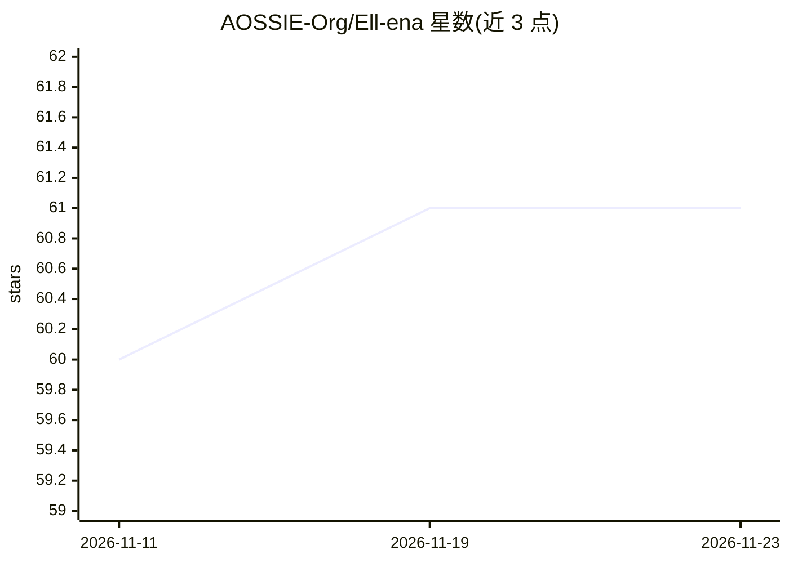

# AOSSIE-Org/Ell-ena

⭐ 61 · Dart · 推送 2026-11-16 · [GitHub](https://github.com/AOSSIE-Org/Ell-ena) · [官网](https://play.google.com/store/apps/details?id=org.aossie.ellena) · 组织维护

**面向任务与会议管理的 AI 产品经理聊天应用**

Ell-ena 是一个 AI 助手型工作管理应用：用户通过聊天界面用自然语言创建待办和工单、转录会议并生成带行动项的摘要，依托 RAG 与向量检索实现上下文感知。技术栈为 Flutter 跨平台前端 + Supabase 后端（PostgreSQL、Row-Level Security、Edge Functions），AI 管线使用 Gemini API 做 NLU、生成嵌入向量并做摘要，会议转录依赖 Vexa API key。项目属 AOSSIE 的 GSoC'25 课题，README 自述仍在积极开发中，安装需自行克隆源码并分别配置后端与前端。

## 筛选速览

| 维度 | 判定 | 备注 |
|---|---|---|
| AI 角色 | `ai-native` | 本体是模型或模型工具 |
| 许可风险 | `none` | — |
| 部署形态 | `None` |  |
| 模型依赖 | — | README 未给出锁定关系 |
| 硬件要求 | — | 无带数字的原话,不猜 |
| 安装摩擦 | `low` | 无编译、无系统依赖或容器化 |
| 成熟度 | `idea` | |

## 能力要点

- 自然语言命令生成待办事项与工单
- 会议转录与上下文笔记，AI 摘要附行动项
- RAG 与向量检索实现上下文感知（PostgreSQL/pgvector）
- Flutter 跨平台 UI + Supabase 后端，支持多账户与团队协作

## 适用场景

- 用对话方式管理任务、工单和会议记录
- 会后自动生成带行动项的摘要与上下文笔记
- 团队协作场景下统一管理工作上下文

## 场景标签

`AI 助手` `聊天机器人` `RAG` · 领域:对话与助手

## 证据(README 行号)

> L3: **Ell-ena** is your AI-powered teammate that makes managing work effortless. From automatically creating tickets to 
> L46: - Generate to-do items and tickets using natural language commands
> L50: - RAG (Retrieval-Augmented Generation) implementation for contextual intelligence
> L75: - **NLU Processor**: Processes natural language using Gemini API

## 星数曲线

2026-11-11 60 → 2026-11-23 61（+1）

---
*卡片 v1 · prompt 1.4 · 生成 2026-11-18 · 置信度 high · 依据 README sha `e013c11400b4` · [字段定义](../../DATASET.md)*
