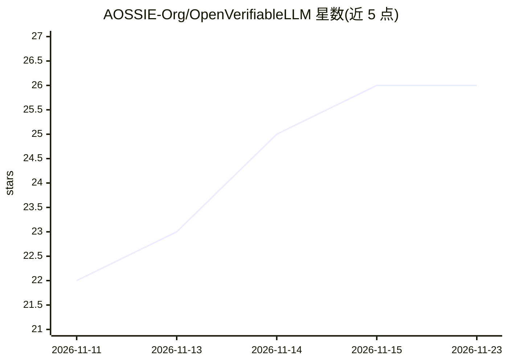

# AOSSIE-Org/OpenVerifiableLLM

⭐ 26 · Python · GPL-3.0 · 推送 2026-11-18 · [GitHub](https://github.com/AOSSIE-Org/OpenVerifiableLLM) · [官网](https://huggingface.co/datasets/AOSSIE/openverifiable-enwiki-20260901-20260918-r1-evidence) · 组织维护

**可逐段复算训练过程的开放权重 LLM 项目（含 23.1M 模型与验证工具）**

AOSSIE 维护的可验证 LLM 项目：发布一个 23.1M 参数、在英文 Wikipedia 上单轮训练的开放权重模型，并将训练记录拆为 37 个 segment（SHA-256 链式哈希、RFC 3161 双时间戳），供任何人在同型 GPU（RTX 5090）上逐段复算比对。提供三层流程：ollama 直接体验模型、无 GPU 的一致性检查（下载发布记录核对哈希）、租用 GPU 完整验证。训练确定性依赖固定种子、确定性 CUDA kernel、禁用 TF32。README 明示限制：模型小且常出错、位级一致仅限同型 GPU、尚无项目外独立验证。

## 筛选速览

| 维度 | 判定 | 备注 |
|---|---|---|
| AI 角色 | `ai-native` | 本体是模型或模型工具 |
| 许可风险 | `viral` | GPL-3.0 |
| 部署形态 | `library` | 以包/库形式分发 |
| 模型依赖 | local-ok | 支持本地模型 |
| 硬件要求 | — | 无带数字的原话,不猜 |
| 安装摩擦 | `medium` | 含编译或系统依赖之一 |
| 成熟度 | — | 结构信号不足 |

## 能力要点

- 37 个训练 segment 全部在第二台机器上逐位复算一致
- 训练数据可从 Wikipedia 原始 dump 逐字节重建
- chain.jsonl 哈希链 + DigiCert/FreeTSA 双时间戳锚定发布记录
- 无 GPU 的笔记本一致性检查（约 10 分钟）

## 适用场景

- 我训练/使用 LLM 前想核对它的训练过程是否可复现
- 我在 RTX 5090 上租卡独立验证某个训练 segment 并提交结果
- 我研究确定性训练与训练溯源的可复现性方案

## 场景标签

`模型训练` · 领域:训练与推理

## 证据(README 行号)

> L15: **The first release** is a 23.1M-parameter model, trained on one exact pass over all of English
> L59: ollama run ryoari/openverifiablellm "Tell me about the Moon."
> L92: Training is deterministic (fixed seed, deterministic CUDA kernels, no TF32). Every step checks that

## 星数曲线

2026-11-11 22 → 2026-11-23 26（+4）

---
*卡片 v1 · prompt 1.4 · 生成 2026-11-18 · 置信度 mid · 依据 README sha `32f3e7a474ae` · [字段定义](../../DATASET.md)*
