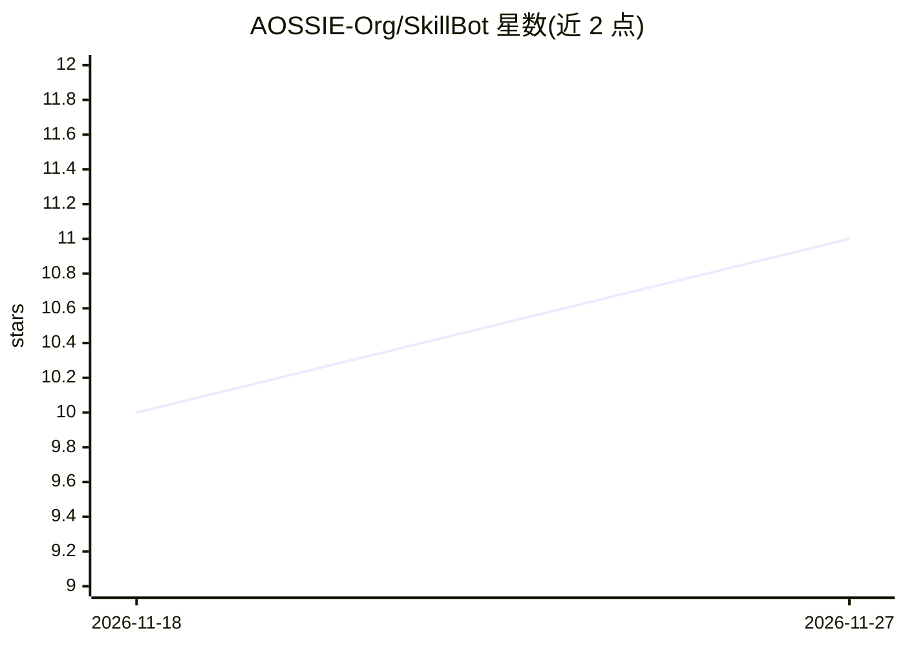

# AOSSIE-Org/SkillBot

⭐ 11 · Python · NOASSERTION · 推送 2026-11-16 · [GitHub](https://github.com/AOSSIE-Org/SkillBot) · 组织维护

**本地运行的 Discord 机器人：用仓库文档回答贡献者提问**

面向开源社区与团队的 Discord 问答机器人，以各仓库自身的 Markdown 文档为知识源回答贡献者提问。启动及每日同步文档到 repos/，按问题名称与关键词路由到对应仓库，只发送匹配文档并施加 2000/4000 字符预算以适配本地模型；歧义问题先追问澄清，每个问题开独立线程。通过 Ollama 本地推理，无 API 费用与速率限制；无法路由或找不到文档的问题记入 gap_log.json 供维护者补文档。

## 筛选速览

| 维度 | 判定 | 备注 |
|---|---|---|
| AI 角色 | `ai-native` | 本体是模型或模型工具 |
| 许可风险 | `none` | NOASSERTION |
| 部署形态 | `library` | 以包/库形式分发 |
| 模型依赖 | local-ok | 支持本地模型 |
| 硬件要求 | — | 无带数字的原话,不猜 |
| 安装摩擦 | `low` | 无编译、无系统依赖或容器化 |
| 成熟度 | — | 结构信号不足 |

## 能力要点

- 仓库路由：按名称与关键词定位问题所属仓库，回退到本地 LLM 分类
- 仅发送匹配文档并限制总长度预算，可在普通电脑上运行
- gap_log.json 记录无法回答的问题，提示缺失文档
- 支持 .agent/ 目录布局与自定义分支仓库配置

## 适用场景

- 开源社区用 Discord 自动回答贡献者的安装与上手问题
- 为组织多个项目仓库配置统一的文档问答机器人
- 通过 gap log 找出需要补充撰写的文档

## 场景标签

`文档问答` · 领域:知识与检索

## 证据(README 行号)

> L6: **Skill Bot** is a Discord bot that answers contributors' questions about your project's repositories, using each re
> L12: * **What:** a bot that works out which repository a question is about, picks the docs from that repository that mat
> L25: * **Fully Local Inference**: Uses a local Ollama model (such as `llama3.2` or `qwen2.5:7b`). No contributor data le

## 星数曲线

2026-11-18 10 → 2026-11-27 11（+1）

---
*卡片 v1 · prompt 1.4 · 生成 2026-11-20 · 置信度 high · 依据 README sha `a90b21f21f3a` · [字段定义](../../DATASET.md)*
