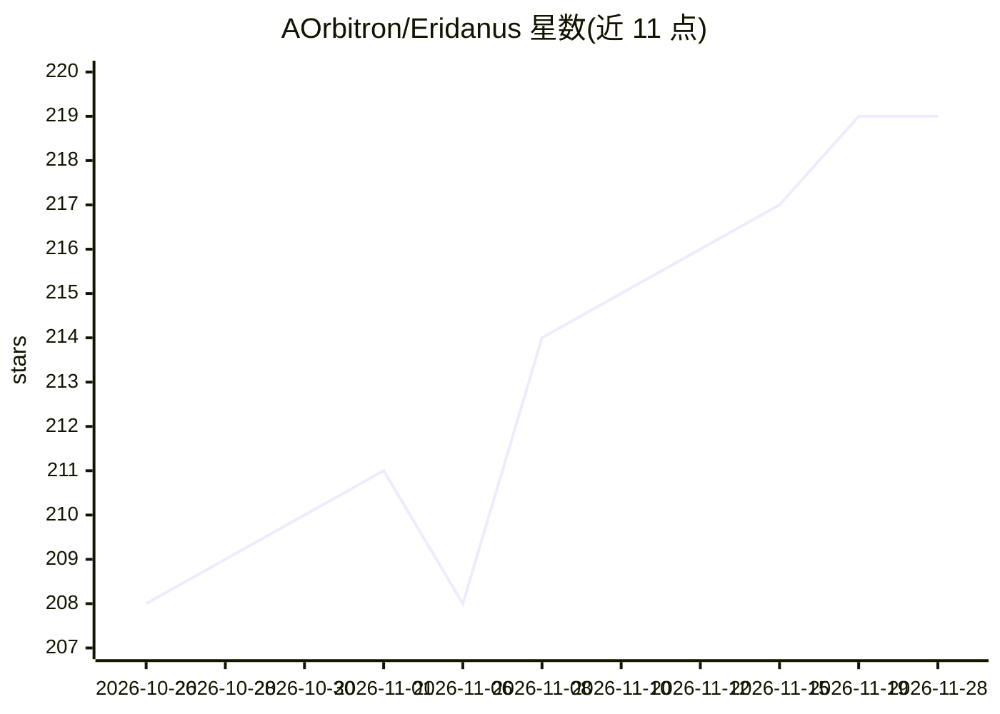

# AOrbitron/Eridanus

⭐ 219 · Python · NOASSERTION · 推送 2026-11-27 · [GitHub](https://github.com/AOrbitron/Eridanus) · [官网](https://eridanus.netlify.app) · 个人维护 · 中文 README

**面向 QQ 等多端聊天场景的 OneBot 协议 bot 框架**

基于 OneBot v11 协议标准与事件驱动 Hub 的多端桥接框架：QQ、WebUI、Telegram 与 Android 悬浮窗应用共享同一套插件实例与上下文，入站消息统一规范化后透传处理。以 LLM function calling 为核心构建功能调用机制，支持 Telegram 相册合并、文件原样传输、跨端会话绑定，以及不接入 QQ 的纯 Live2D 桌宠模式。提供文档站与快捷部署方式，采用 CC BY-NC-SA 4.0 非商业许可。

## 筛选速览

| 维度 | 判定 | 备注 |
|---|---|---|
| AI 角色 | `ai-ecosystem` | LLM/agent 周边工具 |
| 许可风险 | `none` | NOASSERTION |
| 部署形态 | `None` |  |
| 模型依赖 | — | README 未给出锁定关系 |
| 硬件要求 | — | 无带数字的原话,不猜 |
| 安装摩擦 | `low` | 无编译、无系统依赖或容器化 |
| 成熟度 | — | 结构信号不足 |

## 能力要点

- 多端统一桥接：QQ/WebUI/Telegram/Android 共享插件实例与上下文
- 以 LLM function calling 为核心的功能调用机制
- 支持不接入 QQ 的纯 Live2D 桌宠模式
- Telegram 合并转发相册化与文件原样传输

## 适用场景

- 为 QQ 群搭建多功能聊天机器人
- 在 Telegram 与 QQ 之间同步会话与长期记忆
- 把 bot 同时接入多个平台而无需重复部署实例
- 作为 Live2D 桌宠与助手使用

## 场景标签

`聊天机器人` · 领域:对话与助手

## 证据(README 行号)

> L5: _🎊 基于 OneBot 协议的多功能bot兼python开发框架 🎊_
> L33: Eridanus 采用基于 **OneBot v11 协议标准**与**事件驱动中心 Hub** 的多端统一桥接架构：无需重复启动多份 Bot 核心插件，通过 WebUI 服务端作为 WebSocket Hub 中转，实现 QQ、
> L49:  - Eridanus 作为标准 OneBot 客户端连接本地 Hub，所有插件仅在内存中加载一次，无需为每个平台单独拉起 Bot 实例。

## 星数曲线

2026-10-26 208 → 2026-11-28 219（+11）

---
*卡片 v1 · prompt 1.4 · 生成 2026-11-28 · 置信度 high · 依据 README sha `ce6ccb9ea912` · [字段定义](../../DATASET.md)*
